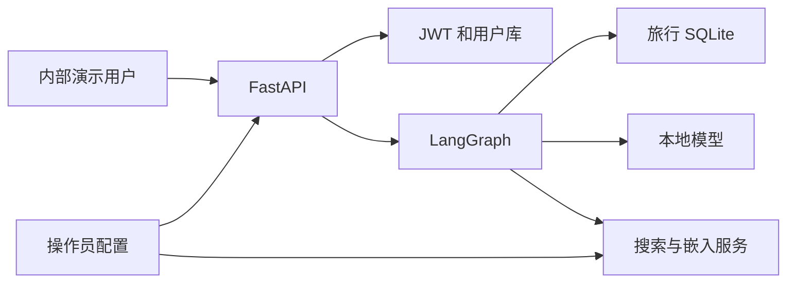

# 携程智能旅行助手威胁模型

## Executive summary

按用户确认的“内部演示系统”评估，首要风险是演示账号可提交任意旅客 ID 和会话 ID，进而影响行程数据与对话状态；用户管理接口也缺少对象和角色授权。项目还包含写在源码中的服务凭证。若未来接入真实订单或面向公网，须重新定级并先完成这些边界的修复。

## Scope and assumptions

- 范围：`main.py`、`api/`、`utils/`、`db/`、`graph_chat/finally_graph.py` 与其依赖的 `tools/`。入口是 FastAPI；`graph_chat/graph_gradio.py` 及中文命名流程图文件视为演示/示例入口，不视为当前 `main.py` 暴露的 API。
- 已确认：目标为内部演示系统。假定仅使用模拟用户和订单数据，访问人员仍可能拥有不同账号；内部网络与第三方服务并非可信授权边界。
- 未确认：内网访问控制、反向代理、用户数量、是否有真实密钥与真实行程数据。相关优先级以“没有仓库外额外控制”为保守假设；有配置证据后可调整。
- 仓库未发现依赖清单、CI 或容器部署文件；这些属于交付缺口，不能当作运行时安全控制。

## System model

### Primary components

- HTTP/API：`main.py:12-40` 创建 FastAPI，`api/routers.py:7-18` 挂载用户和工作流路由。
- 身份：`utils/middlewares.py:19-66` 校验 Bearer JWT 和白名单；`api/system_mgt/user_views.py:46-97` 登录发令牌；`db/system_mgt/user_dao.py` 操作用户库。
- 工作流：`api/graph_api/graph_views.py:13-40` 接收问题与配置；`graph_chat/finally_graph.py:24-114` 组织 LangGraph、内存检查点与敏感工具中断。
- 数据/外部依赖：`tools/__init__.py:6-9` 指向本地 SQLite 旅行数据；`db/__init__.py:19` 创建用户数据库引擎；`graph_chat/llm_tavily.py:16-20,43-44` 配置本地模型和搜索服务；`tools/retriever_vector.py:25-27,38-43` 调用嵌入服务。

### Data flows and trust boundaries

- 演示用户 → API：HTTP JSON、令牌、问题、旅客 ID、会话 ID 跨越用户/服务边界。JWT 在 `utils/middlewares.py:43` 校验；Pydantic 解析请求，但身份字段在 `api/graph_api/graph_schemas.py:12-13` 由客户端提供；仓库未见请求量限制。
- API → 用户数据库：登录与用户资料经 SQLAlchemy 访问，部分路径使用 bcrypt；`api/system_mgt/user_views.py:25-32,99-107` 未见角色/对象授权。
- API → LangGraph → 旅行 SQLite：问题及配置进入工具链。`tools/flights_tools.py:19-40` 用旅客 ID 查询，部分写入在 `:172-173` 核对归属；其他预订工具如 `tools/hotels_tools.py:56-72` 直接按对象 ID 修改。
- LangGraph → 模型/搜索/嵌入：用户问题、工具结果或查询可能经本地模型、外部搜索和嵌入服务处理；提示词与第三方结果属于非可信内容。依据：`graph_chat/assistant.py:60-95`、`graph_chat/llm_tavily.py:16-20,43-44`、`tools/retriever_vector.py:38-49`。
- 操作员 → 配置/密钥：配置文件与源码中的密钥越过开发环境和运行环境边界，位置见 `config/development.yml:11,15,21`、`graph_chat/llm_tavily.py:11,26,32,38,43`；报告不包含实际值。

#### Diagram

## Assets and security objectives

| Asset | Why it matters | Security objective (C/I/A) |
| --- | --- | --- |
| 演示用户身份与 JWT | 控制 API 访问 | C/I |
| 旅客行程、订单和会话状态 | 影响演示数据隔离和操作正确性 | C/I/A |
| 用户数据库及密码哈希 | 包含账号资料与登录凭据 | C/I |
| 模型/搜索/嵌入服务密钥 | 可能产生费用与服务滥用 | C/I/A |
| API、工作流与本地模型容量 | 演示可用性依赖它们 | A |

## Attacker model

### Capabilities

- 拥有一个普通演示账号的人可构造 HTTP 请求，选择请求体中的旅客和会话 ID，并反复请求；依据：`api/graph_api/graph_schemas.py:12-28`。
- 能读取分享过的源码、包或开发机文件的人可能获得源码中的密钥。是否已对外传播未知。
- 搜索结果及用户问题可包含试图改变模型行为的非可信文本。

### Non-capabilities

- 不假设攻击者拥有服务器文件系统、数据库管理员权限或签发 JWT 的密钥。
- 不假设目前面向公网或处理真实订单；用户仅确认内部演示目标。

## Entry points and attack surfaces

| Surface | How reached | Trust boundary | Notes | Evidence (repo path / symbol) |
| --- | --- | --- | --- | --- |
| `/api/register/`、`/api/login/`、`/api/auth/` | HTTP | 用户 → API | 发账号/令牌；实际白名单范围待核验 | `api/system_mgt/user_views.py:35-97` |
| `/api/users/*` | HTTP + JWT | 用户 → 用户库 | 查询、修改、删除用户 | `api/system_mgt/user_views.py:25-32,99-107` |
| `/api/graph/` | HTTP + JWT | 用户 → 工作流 | 问题、旅客 ID、会话 ID | `api/graph_api/graph_views.py:13-40` |
| 工作流工具 | LangGraph 调用 | 模型输出 → SQLite | 查改航班、酒店、租车和游览 | `graph_chat/build_child_graph.py:16-64`；`tools/hotels_tools.py:56-72` |
| 外部搜索与嵌入 | 工具调用 | 工作流 → 第三方服务 | 查询内容及服务密钥 | `graph_chat/llm_tavily.py:43-44`；`tools/retriever_vector.py:25-27,38-49` |
| 配置/日志 | 文件及控制台 | 操作员/开发环境 → 运行时 | 密钥、个人信息及请求输出 | `config/development.yml:11,15`；`api/graph_api/graph_views.py:15-18` |

## Top abuse paths

1. 已登录演示用户把别人的旅客 ID 放入 `/api/graph/` → 工作流按该值查询 → 返回其他旅客行程（`graph_schemas.py:12`；`flights_tools.py:19-40`）。
2. 已登录演示用户重用已知会话 ID → `/api/graph/` 调用 `graph.stream`/`get_state` → 读取或续写其他人的会话；是否可猜到/获知 ID 待验证（`graph_views.py:17-36`）。
3. 普通演示用户指定其他用户 ID 调用修改或删除接口 → 路由直接调用 DAO → 他人账号完整性受损（`user_views.py:99-107`）。
4. 拥有用户修改权限的人提交新密码 → DAO 直接赋值 → 密码可能以明文写库并破坏登录（`user_dao.py:76-81`）。
5. 获得源码副本的人提取未轮换的第三方密钥 → 调用外部服务或耗尽配额（`llm_tavily.py:43`；`retriever_vector.py:26`）。
6. 用户反复提交超长问题或多轮工具请求 → 同步工作流、外部调用和本地模型被占用 → 演示可用性下降（`graph_views.py:14-40`；`graph_schemas.py:21-28`）。

## Threat model table

| Threat ID | Threat source | Prerequisites | Threat action | Impact | Impacted assets | Existing controls (evidence) | Gaps | Recommended mitigations | Detection ideas | Likelihood | Impact severity | Priority |
| --- | --- | --- | --- | --- | --- | --- | --- | --- | --- | --- | --- | --- |
| TM-001 | 普通演示账号 | 能访问 `/api/graph/` | 伪造旅客或会话 ID | 越权读写演示数据 | 行程、会话 | JWT 校验 `middlewares.py:43`；部分机票归属检查 `flights_tools.py:172-173` | 旅客/会话标识来自客户端 | 服务端绑定登录用户、旅客与会话；工具统一授权 | 记录主体与资源 ID，不记录敏感正文；告警跨主体访问 | 高：字段可直接提交 | 高：跨用户数据和操作 | high |
| TM-002 | 普通演示账号 | 有有效令牌 | 调用用户列表、修改或删除其他账号 | 账号信息泄露/篡改 | 用户库 | JWT 校验 `middlewares.py:43` | 路由缺少 RBAC/对象授权 `user_views.py:25-32,99-107` | 管理员路由隔离；普通账号只能访问自己 | 审计主体、目标 ID、操作与结果 | 高：路径明确 | 高：账号完整性 | high |
| TM-003 | 源码接收者 | 获得代码或配置副本 | 使用嵌入/搜索等服务密钥 | 服务费用、额度和数据风险 | 服务凭证 | `.gitignore` 排除本地配置 | 密钥在 Python 源码，注释也保留旧值 | 轮换有效密钥；环境注入；扫描历史 | 供应商用量和异常来源告警 | 中：传播范围未知 | 高：密钥滥用 | high |
| TM-004 | 有修改能力的演示账号 | 可提交用户更新请求 | 将密码作为普通字段写入 | 明文存储或登录失败 | 用户库 | 创建用户时 bcrypt `user_views.py:39-43` | 更新直接赋值 `user_dao.py:76-81` | 单独密码变更流程，写前哈希并验证旧密码 | 监控密码更新失败和异常哈希格式 | 中：依赖访问路径 | 中：影响账号 | medium |
| TM-005 | 演示用户 | 可连续发送问题 | 消耗模型、工具和数据库资源 | 演示中断 | 服务容量 | 敏感操作中断 `finally_graph.py:109-114` | 无可见请求/并发/输入上限 | 限长、限流、超时、工具调用配额 | 监控耗时、调用次数、队列长度 | 中：内部访问 | 中：影响可用性 | medium |
| TM-006 | 非可信问题/搜索内容 | 模型消费非可信文本 | 诱导模型选择或解释工具结果 | 错误建议或非预期操作 | 工作流完整性 | 敏感工具前中断 `finally_graph.py:109-114` | 确认未见服务端绑定发起者/资源 | 确认请求与具体操作及会话绑定；工具做独立授权 | 记录工具调用、确认者和参数摘要 | 中：输入可控 | 中：演示数据影响 | medium |

## Criticality calibration

- critical：在公网或真实数据条件下，可无认证读取大量旅客信息；或可无认证执行真实订单修改。当前已确认的内部演示范围内未把任何发现定为 critical。
- high：一个演示账号可读取别人的行程；或可改删别人的用户账号；或已传播的有效服务密钥被滥用。
- medium：单个账号的密码更新失败/明文保存；或重复提问耗尽演示服务容量；或提示注入导致模拟操作异常。
- low：仅暴露不敏感的接口文档；或对模拟数据产生可快速恢复的短时日志噪声。该级别仍取决于部署层可见性。

## Focus paths for security review

| Path | Why it matters | Related Threat IDs |
| --- | --- | --- |
| `api/graph_api/graph_schemas.py` | 客户端可设置身份和会话字段 | TM-001 |
| `api/graph_api/graph_views.py` | 直接把配置传给工作流与状态读取 | TM-001, TM-005, TM-006 |
| `utils/middlewares.py` | 令牌解析与主体绑定入口 | TM-001, TM-002 |
| `api/system_mgt/user_views.py` | 用户管理缺少细粒度授权 | TM-002, TM-004 |
| `db/system_mgt/user_dao.py` | 密码更新与批量删除 | TM-002, TM-004 |
| `graph_chat/finally_graph.py` | 会话状态和敏感操作中断 | TM-001, TM-006 |
| `tools/flights_tools.py` | 旅客 ID 查询与部分归属检查 | TM-001 |
| `tools/hotels_tools.py` | 按对象 ID 修改酒店演示数据 | TM-001, TM-006 |
| `graph_chat/llm_tavily.py` | 服务密钥和搜索边界 | TM-003, TM-006 |
| `tools/retriever_vector.py` | 嵌入服务密钥与查询传输 | TM-003, TM-006 |

## Notes on use

- 已覆盖发现的 FastAPI 入口、工作流工具、数据库、外部服务和配置边界；演示脚本与当前 API 运行入口分开看待。
- 用户确认“内部演示系统”；模拟数据、内网隔离与仓库外网关控制仍是待核验假设。接入真实数据或公网时需要重做风险排序。
- 本文是静态模型，不代表已执行渗透测试或启动应用。优先验证 TM-001、TM-002 和 TM-003，再补自动化隔离测试。
