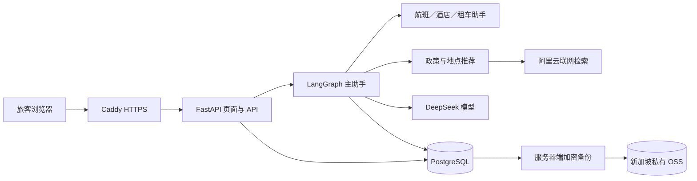

# 系统架构

## 组件

FastAPI 提供同源旅客页面、认证、候选查询、会话和交易确认接口。LangGraph 组织多轮对话；航班、酒店、租车及地点推荐仍以服务端可核对的数据为事实来源。PostgreSQL 保存旅客、虚构供给、订单、会话、检查点、待确认动作和审计记录。模型不能直接写订单；确认接口在数据库事务中重新核对归属、对象、规则、报价与版本。

## 身份与数据边界

登录令牌绑定服务器端旅客身份；客户端提供的会话 ID 或对象 ID 不能改写归属。每次读取、创建卡片与确认都核对当前账号。外部网页和模型输出属于不可信输入，不可当成交易指令或平台政策。页面使用文本渲染外部内容，公网关闭 API 文档和内部健康端点。

正式环境由 `compose.cloud.yaml` 与 `compose.cloud.2g.yaml` 组成：`db`、`app`、`proxy` 为常驻服务；初始化、空库备份和账号管理在显式 profile 下运行。五个持久卷分别保存 PostgreSQL 数据、迁移前备份、批次清单和 Caddy 证书／配置。数据库与应用无宿主机公网端口；代理发布 80／443。本机隔离体验使用 `compose.container.yaml` 与独立项目、独立卷。

虚构航线和审查过的地点目录在 `data/fixtures/`。产品与报价可按指定演示日期确定性生成；批次清单和数据库摘要在应用启动时核对，普通重启不会重导数据。历史演示批次和原始数据源不随代码部署覆盖。

## 代码目录

| 路径 | 职责 |
| --- | --- |
| `travel_assistant/api/`、`web/static/` | HTTP 接口与旅客页面 |
| `travel_assistant/agents/` | 受控多助手对话 |
| `travel_assistant/services/` | 供给、订单、政策与推荐规则 |
| `travel_assistant/core/`、`db/` | 配置、身份、数据库连接和模型 |
| `migrations/` | 版本化 PostgreSQL 迁移 |
| `scripts/`、`deploy/` | 部署、管理、备份与审计工具 |
| `tests/` | 离线业务、对话、页面和运维回归 |
