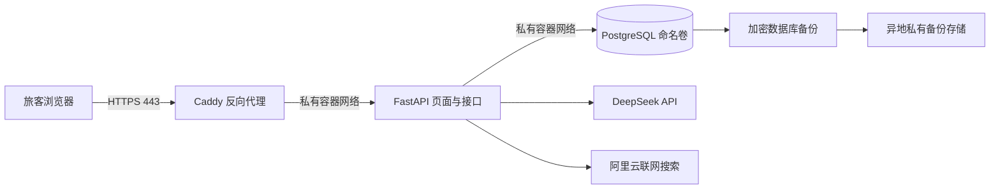

# P3.4b：云端选型与上线准备操作计划

> 2026-10-25 制定，**待旅客确认后执行**。承接[P3.4 总路线](P3.4-容器化与云部署分步路线.md)和[P3.4a 验收记录](../P3.4a-本机容器化验收记录.md)。本计划完成云端选型、配置改造与隔离验收；服务器和域名的购买、公网开通、正式数据初始化留待 P3.4c 独立计划及确认。实施结果写入[当前进度](../当前进度.md)。

## 一、已确认的目标与现状

- 项目是求职作品，按企业项目的登录、交易确认、数据保护、恢复和运维标准建设；业务仍是**虚构供给与模拟订单**，没有真实付款和供应商交易。
- 知道链接的人可访问登录页面；只有预先授权的账号可以登录。禁止开放注册和共享演示账号。网站只在展示前开启，平时关闭。
- 服务器及基础运维目标为 **¥50～150／月**。DeepSeek 与阿里云联网搜索调用费单列。旅客不要求给模型／搜索设金额自动停机线；应展示用量，在余额或额度不足、服务商拒绝时及时提醒。防滥用的频率与并发限制仍需要实施。
- 使用阿里云中国站账号，尚未购买域名；地域由本计划比较后推荐。域名首年、续费与备份存储均计入基础运维估算，不能只看服务器促销首月价。
- 本机 P3.4a 已验证容器、独立卷、显式初始化、重启和备份恢复；**当前容器配置仅适用于本机隔离验收**：`compose.container.yaml` 固定读取本机生成的环境文件，且强制将模型密钥置空、联网搜索关闭，应用只映射到 `127.0.0.1`。云端不能直接照搬它并声称有真实模型与搜索。现有 8000→5436、本机旧批次及备份不作为云端试验对象。

## 二、选型建议与费用判断

**首选：阿里云中国站的中国香港轻量应用服务器，Linux x86_64、2 vCPU／4 GiB、系统盘至少 40 GiB，按月购买一个月，自动续费关闭。**它与现有账号一致，单机管理较容易，也可容纳反向代理、应用和 PostgreSQL。2 GiB 只在三服务的真实峰值内存、恢复和并发测试通过后作为降配备选；2 vCPU／4 GiB 是初始评估规格，购买页可用规格和价格必须重新核对。[阿里云实例规格](https://help.aliyun.com/zh/simple-application-server/product-overview/instance-families/)列出了香港地域与规格族；[购买说明](https://help.aliyun.com/zh/simple-application-server/user-guide/create-a-server)明确各地域可选套餐以控制台为准。

| 方案 | 适合之处 | 代价／放行条件 |
| --- | --- | --- |
| 阿里云香港轻量应用服务器，首选 | 使用已有账号，管理入口集中；香港服务器按阿里云说明不需内地 ICP 备案 | 只支持包月等预付周期，关机**不会退还已付当月套餐费**；内地访问香港跨境链路可能慢。中国站实际结算价、流量包及续费价要在购买页核实。 |
| 阿里云香港按量付费 ECS，备选 | 真正短期使用时可选择节省停机或在备份后释放计算资源 | 云盘、可能的公网 IP 等仍可能计费；停机模式可能导致 IP 变化，域名需要重绑；实例与网络计费比轻量服务器复杂。先不作为第一次部署路径。 |
| 中国内地轻量服务器，后续备选 | 面试访问主要在内地时通常更容易得到稳定链路 | 对外网站需要先完成 ICP 备案，且阿里云轻量服务器备案相关购买周期可能长于一个月；不适合本次快速上线。 |
| 腾讯云香港轻量服务器，价格兜底 | 官方公开价表中有 2 vCPU／4 GiB 的套餐 | 要新增并维护第二家云账号；需重新验证价格、网络质量、备份和运维步骤。只有阿里云实际报价超预算或网络实测明显不佳时再比较。 |

阿里云官方说明：[香港服务器不需内地 ICP 备案](https://help.aliyun.com/zh/icp-filing/basic-icp-service/support/server-check-faq)、[轻量服务器只支持包年包月](https://help.aliyun.com/zh/simple-application-server/product-overview/upgrade-and-renew-a-simple-application-server)、[香港跨境访问可能有较高延迟](https://help.aliyun.com/zh/simple-application-server/user-guide/create-a-server)。[按量 ECS 计费说明](https://help.aliyun.com/zh/ecs/pay-as-you-go-1)列出了普通停机、节省停机、云盘和公网 IP 的不同计费；[腾讯云公开价表](https://cloud.tencent.com/document/product/1207/73452/)仅作兜底比较。香港无需内地 ICP 备案不等于无需完成域名实名或其他适用合规要求；正式上线前单独核对。

**费用放行线**：在阿里云中国站购买页记录同一规格的首购价、正常续费价、流量与超额流量价、是否另需数据盘及镜像费用；目标服务器正常月价 **≤¥120**，域名续费年价折算和异地备份合计留 **≤¥30／月**，总计 **≤¥150／月**。这只是决策阈值，不是当前报价。若正常续费价或预计流量让总额超出范围，就暂停购买，给出具体报价与 ECS／其他厂商比较，再让旅客决定。域名购买前核对可用名称、首年与续费价、信息模板实名认证、退款条件；[阿里云域名注册指南](https://help.aliyun.com/zh/dws/user-guide/how-to-register-a-domain-name)说明实名模板要求。云资源、域名、模型和搜索账单分别记录，不把促销折扣写成长期成本。

“平时关闭”按**关闭公网访问／停止服务**处理：可减少暴露和付费 API 消耗，但包月服务器费用仍按已购买周期计算。购买时关闭自动续费，演示结束后先备份再停止；下次展示至少提前一天开机、核对域名和 HTTPS 证书、执行真实旅程烟测。若后续发现每月只使用很少几天，再单独评估 ECS 按量方案与域名 IP 变化成本。

## 三、目标部署图与访问边界

1. 域名只解析到展示服务器。公网只开放 80（证书签发及跳转）和 443；SSH 使用密钥并限制来源地址。应用 8000、PostgreSQL 5432、管理与健康接口均不直接发布公网。Caddy 只向容器私网中的应用转发。其[自动 HTTPS 条件](https://caddyserver.com/docs/automatic-https)包括正确的 DNS、80／443 可达以及持久化证书目录。
2. 登录页可公开访问，账号由管理员预先创建、发放和停用；面试官使用独立账号及强随机密码，不复用 `demo1`、本机 JWT 密钥或本机数据库口令。普通旅客只能访问本人会话和订单；九类写动作继续逐张确认。退出、过期、重复确认、跨账号访问及刷新仍按当前事务规则执行。
3. 云端使用新的 Git 忽略配置与秘密，不把 `.env`、数据库备份、账号清单或密钥写入仓库、镜像及日志。容器环境变量对有 Docker 管理权限的人可见，因此服务器管理员权限、配置文件权限和备份访问权限都要收紧。云端批次只能显式初始化空库；容器重启不得重新导入、更新日期或重置订单。保留本机旧卷与 5436 批次。
4. 登录请求设失败频率限制，模型／搜索请求设每账号速率与并发上限，记录可识别滥用的审计事件；这些是防滥用措施，不是用户拒绝的金额停机线。管理员可查看每日请求量和服务商账单；余额不足、鉴权失败或配额耗尽时，在页面给出明确提示并记录告警，不伪造已联网答复。联网搜索默认开启，在来源核验失败时退回已核查地点目录。
5. 只开放实际需要的旅客路由；生产环境的自动 API 文档和内部就绪／管理入口需关闭或只允许本机／管理员访问。设置代理信任边界、域名白名单、HTTPS 跳转和基础安全响应头；不信任任意转发头。Docker 官方说明发布端口可能绕过主机 `ufw` 规则，因此同时检查云防火墙和实际容器发布列表：[Docker 安装与防火墙说明](https://docs.docker.com/engine/install/ubuntu/)。

## 四、P3.4b 获确认后的具体操作顺序

1. **开工核对**：重读三份核心文档、本计划和 P3.4a 验收；核对 `main`、工作区、当前 8000／5436 运行身份、Compose 与配置。记录阿里云中国站可购买的香港 2 vCPU／4 GiB Linux 套餐、流量、首购／续费价及域名首年／续费报价，**只到订单确认页，不支付**。如果工作台无法进入账号控制台，只请旅客提供不含个人资料的规格与价格截图或文字；不索要密钥。
2. **独立功能分支与最小改造**：核对 `main` 上待提交内容仅为本次计划、索引和进度后，创建本地功能分支并先提交已确认的规划文件；来源不明的改动不得混入。保留现有本机 Compose；新增独立云端配置入口，使模型、联网搜索、域名、数据库地址、端口和密钥从云端专用忽略文件读取。配置校验在缺少必要密钥／域名时明确失败；不能把本机“强制关闭 AI／搜索”的测试值无意带入云端。重新核对 API 提供方支持的真实模型标识、搜索引擎及账单：当前[阿里云计费页](https://help.aliyun.com/zh/document_detail/3061214.html)没有列出既有 `GlobalBasic` 单价，尽管[接口文档](https://help.aliyun.com/zh/document_detail/3062218.html)列出该参数；本轮不得凭其他版本价格推定账单，亦不得静默切换搜索引擎。
3. **公网访问保护**：加入 Caddy 反向代理的独立部署文件与持久证书卷；云防火墙仅放通 80／443 和受限 SSH，应用与数据库不发布公网。实现或复核账号预置／停用、登录失败限制、每账号模型／搜索频率及并发限制、登录与交易审计、密钥脱敏、服务商余额／配额错误的用户提示。保持模拟交易逐笔确认与跨账号隔离。账户信息只给本人，不在测试报告中出现密码。
4. **可重建与备份方案**：固定基础镜像版本与摘要，锁定完整 Python 依赖，验收镜像不含秘密和原始数据库。设计 `pg_dump` 定期备份、加密后传到服务器外的私有存储；每次演示结束和每次更新前额外备份，至少保留 7 份日备份，给出生命周期和恢复演练入口。轻量服务器快照可在升级前另作辅助，但[官方说明](https://help.aliyun.com/en/simple-application-server/user-guide/manage-snapshots)每台最多三份，实例释放时快照也被删除，不能替代异地备份。恢复时必须先核对目标为空库、项目标签、卷、备份哈希和业务摘要。
5. **隔离验收**：在本机新 Compose 项目、新卷、新端口跑云端配置替身，不动 8000／5436。验证未登录、未授权、跨账号、登录暴力尝试、速率与并发、代理路由与本地 TLS 配置、错误域名、九类交易提案／确认、防重复写入、来源核验、凭证泄漏检查。正式域名的公开证书和服务器公网端口只能在 P3.4c 购买部署后验收。仅在确有必要时用已授权密钥做少量真实 DeepSeek／联网搜索连通测试，逐次记量并核对真实账单；不把无价目依据的 `GlobalBasic` 用量说成已知费用。重启与全新卷恢复后比对会话、订单、卡片、审计；运行完整自动化回归。
6. **文档与收尾**：补面向初学者的逐项操作说明、费用清单、开机／停机／证书核对、账号发放与撤销、备份／恢复、错误排查和回退。结果只写入《当前进度》与验收记录。仅在功能分支提交本轮代码和文档；公开主线合并与 GitHub 同步另拟独立计划。P3.4c 再给出具体购买、部署和公网验收操作，逐项征求确认。

## 五、验收与停止条件

- **选型**：有阿里云中国站购买页的首购和正常续费实价、域名报价、流量与超额费用；基础运维估算不超过 ¥150／月。先用地域网络测量工具评估香港线路；实际服务器至展示地点的访问延迟、DeepSeek／搜索连通性在 P3.4c 上线前实测。报价不满足则只给替代方案，不购买。
- **访问**：本机隔离环境中，匿名只看到登录；未预置账号不能登录；不同账号互不可读；配置检查显示管理入口、数据库与应用原始端口不会发布公网。已确认订单由本人明确点确认才变更。正式域名证书、HTTP 跳转及外部端口扫描列为 P3.4c 的公网放行门槛。
- **费用提醒**：按账号和全站可查看请求量；服务商返回余额或额度不足时有可理解的提示及管理员可见记录。正常调用不按金额自动停机；异常频率与并发仍受限。
- **恢复**：备份实际在全新空卷恢复，迁移、日期、航线、订单、会话、动作和审计摘要一致；重启不初始化。单机预算不承诺高可用，设计恢复目标为下一次展示前完成恢复，实际耗时以 P3.4c 演练记录为准。
- **风险阻断**：密钥进入镜像／公开文件、云端关闭模型或搜索却未明确告知、非空库被初始化、未授权登录成功、未确认改订单、备份无法恢复、价格超预算、香港线路无法完成展示，均停止进入 P3.4c，先修复或重新选型。

本计划**不授权**购买或续费服务器／域名、公开网站、迁移本机正式订单、关闭 8000、覆盖数据卷、合并 `main` 或推送 GitHub。P3.4b 通过后另拟 P3.4c 云端部署与验收计划，旅客审阅后再执行。
