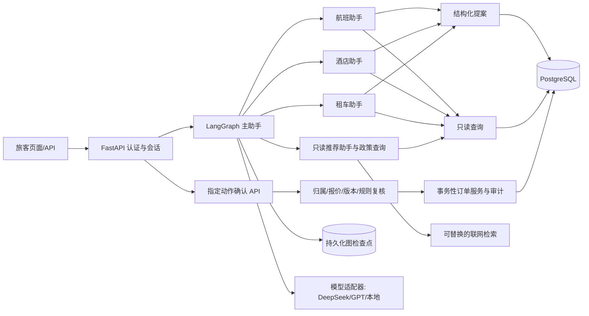

# 软件架构：旅行助手作品项目

> 版本：v0.12｜日期：2026-10-20｜状态：已确认目标架构；P3.1c 日期校准与对话修复在功能分支验收，G-16 主线发布待确认；现有实现边界见《当前进度》

## 1. 原则与当前基线

保留 Python、FastAPI、LangGraph 主助手委派航班/酒店/租车及推荐专门助手的结构，按单体服务和清楚的模块边界实施。新图保留旧图适用的用户能力，不复用旧 SQLite 写工具、客户端旅客 ID、文本 `y` 确认或进程内检查点；游览写功能已由用户明确取消。PostgreSQL 保存正式产品、订单、会话、待确认动作和审计；本机 Docker 与未来云端使用相同迁移与业务规则。DeepSeek 为主模型，GPT 与本地兼容模型通过适配器接入。简单页面用服务端模板与少量 JavaScript，API 保持 JSON 契约。

服务端身份/会话、九类结构化提案、逐笔确认、事务结果和审计，以及全航线、可达城市酒店/租车产品、航班新预订、租车预订/改期/取消、酒店退款 v4，均已进入主线。新版受控对话图、PostgreSQL 检查点及九类对话提案也已进入主线。P2.6d 隔离评估发现的真实航司政策分流、待确认卡撤回、候选短序号和口头同意问题，已在 P2.6e 修复并经受限真实 DeepSeek 定向复测。旧图仍使用 SQLite 写工具、客户端旅客标识、文本 `y` 和进程内 `MemorySaver`，其路由不注册。P2.7 人工核实地点目录覆盖 95 座可达城市，已随主线发布；实时联网来源质量未过线，适配器继续默认关闭。P3.1 旅客页面及 P3.1a 展示优化在功能分支，尚待 G-16 单独发布。具体实现状态以《当前进度》为准。

## 2. 组件与信任边界

模型和外部网页内容都处于不可信边界。模型可调用只读工具、建立待确认提案，不持有订单写服务或确认接口的工具权限。确认请求必须来自已登录旅客；服务端从令牌绑定旅客、会话与动作，模型参数或客户端传入的旅客 ID 不可覆盖。联网结果只作为带来源的信息数据，不能成为交易规则或工具指令。

## 3. 模块职责

- `api/`：认证、会话轮次、订单/产品查询、提案确认与历史；负责请求校验和身份绑定，不直接执行订单 SQL。
- `graph_chat/`：主助手、航班/酒店/租车专门助手和只读推荐助手、状态、路由、澄清和工具权限；旧图保持关闭，新图按已确认功能重建。
- `tools/`：薄封装，只读查询及创建提案；旧 SQLite 写工具不进入新图。
- `services/`：确定性身份授权、模拟价格/政策、产品可用性、待确认动作、订单事务、审计、推荐证据整理和距离计算。
- `db/`、`migrations/`：正式航班/酒店/租车产品与订单、会话/动作/检查点、约束、迁移和种子；不建游览产品、场次或订单表。
- `scripts/`、`data/fixtures/`：从只读原 SQLite 提取非个人样本，整体时间平移、可复现地生成报价/酒店/租车产品并核对覆盖率。
- `static/`：同源轻量旅客页面，展示模型答复、来源、卡片、状态和订单。
- `config/`：模型/检索提供方、超时、限额、数据库及密钥的环境配置；密钥不进入源码、日志或 Git。

## 4. 数据设计与完整航线导入

沿用正式旅客、机场、航班、机票/酒店/租车订单、规则、会话、动作及审计实体；推荐来源 URL、检索时间和证据可随对话轮次保存，是否另建检索元数据表在 P2.7 计划中审定。产品与旅客订单分开；订单有所有者、状态和版本。取消保留订单与审计，不物理删除。旧 `update_excursion` 直接修改共享推荐资料，新图不接入任何游览写工具，也不创建游览产品、场次、库存或个人游览订单。

原虚构库约有 33,121 班航班、115 个机场、618 条航线。提取全部航线及必要的航班/机场字段，过滤个人信息，生成可交付压缩样本或确定性导入工件；不要求新环境持有原 114 MB 大库。导入时用同一时间差平移起降、状态边界与相关订单时间，并正确处理机场当地时区，保留先后关系。未来约 30 天的可预订班次才参与搜索和报价；历史、取消与延误记录按状态处理。发布前验证航线覆盖率、时间窗、机场外键、无效日期与演示订单关联。重置机制须避免在有真实演示操作时静默覆盖订单，明确提示其为演示环境重建。

模拟报价由稳定输入和版本化算法生成，不让模型定价。酒店/租车产品按可达城市、位置、日期和有限可用量生成，产品名称明确为虚构。候选查询有日期/城市索引和分页/数量限制；对话默认最多展示三个符合条件的航班。没有相应班次或产品时返回“没有可预订结果”，不以生成式内容补齐。

P3.1a 的旅客展示目录由 `services/location_labels.py` 统一维护：原 95 座可达城市中文别名供推荐解析继续使用，另补齐 11 座来源城市的展示名，并为 115 个机场给出确定性中文显示名。同城多机场采用可区分名称；登录后的只读 `/api/v1/locations` 从当前数据库机场行返回原代码、英文城市、中文显示名和时区。页面按中文选择后仍向原查询 API 发送规范代码／城市值，交易服务不接收展示名代替标识。原整数示例金额在页面和确定性答复中按 `¥` 与千分位显示；`/api/v1/demo-state` 标注展示币种 `CNY`，订单／报价数值及确认核算保持原样。未知名称安全回退原值，不推测实际机场或价格。

## 5. 政策与动作协议

原 `order_faq.md` 经过去品牌、冲突清理后转成版本化虚构平台政策。规则记录 ID、版本、生效范围、条文、可机器计算参数。系统用于交易的政策来自规则表；政策检索仅解释规则，不能替代服务层校验。已确定：航班改签只补/退票价差，取消收原价 30%；租车原取车前可保持车辆不变改期，按新旧总价补退差额，无改期费；原取车前取消模拟全退，到取车时刻后不得改期或取消；酒店在产品机场当地入住日期前取消模拟全退，入住日起禁取消，同日仍可预订或改期。酒店规则为 v4，v3 留作历史审计；租车改期规则为 v3，v2 留作历史审计。确认时重新按当地时间、订单金额及政策版本计算，旧卡失效。真实航司政策只可作为带来源的外部参考，不能决定模拟订单交易。

提案服务校验产品、旅客和规则，保存规范化参数、旧/新快照、模拟价格、规则版本、有效期、会话与幂等键。确认服务在单笔事务中重新检查身份、归属、状态、时间、订单版本、报价和可用性，执行一笔业务状态变更与审计。拒绝/过期/价格变化使旧卡失效；重复确认返回既有结果。模型文字、网页文字和通用文本 `y` 均不能确认动作。

## 6. 多轮模型与检查点

新轮次接口以已验证的服务端会话 ID 作为图线程边界，`chat_messages` 保存页面历史，PostgreSQL 图检查点保存内部运行状态。两者通过会话和请求幂等标识关联；进程重启可恢复，演示重置同步清理。模型调用期间不持有订单事务锁。轮次失败必须清楚呈现，不得说已执行；工具调用重试不重复生成卡片。

模型适配器统一消息和结构化工具调用接口，设置超时、单轮工具步数/结果量、并发与费用限制。政策回答须先取得正式规则证据，再核对规则 ID、版本与关键结论；订单状态、价格和候选班次等事实须能对应工具结果，无法核对时不输出肯定断言。DeepSeek 是真实演示的主路径；GPT 和本地模型可切换，但本地模型须通过工具调用能力验证才能提出交易动作。没有配置密钥时，健康检查及非模型 API 可继续工作，对话返回明确配置状态。用户在实际模型测试前按说明把 API 密钥写入 Git 忽略的本机 `.env`，不在聊天中发送。

## 7. 联网推荐与证据

推荐检索采用可替换的提供方接口；首个真实适配器接入阿里云 CleverSee 国际版 `GlobalBasic`。只对当前模拟航班可达城市给出经典地点推荐；城市和国家先由受控机场代码、城市、时区与随仓库交付的 IANA 时区映射校验，无法唯一确认时不检索。搜索只发送城市、国家和主题，不发送旅客信息；摘要增值项关闭。P2.7c 的全城抽查证明实时搜索标题与摘要不足以稳定判断具体地点和来源可读性，所以后续以人工核实、可版本化的地点目录作为事实基线，实时搜索只用于补充和新鲜度检查。对话正文可只介绍地点与理由，结构化引用保留来源和审查时间；不设游览产品浏览页。酒店到景点的“附近”仅在有可信坐标时计算直线距离，不能写成驾驶/步行时间。不可达城市返回覆盖范围说明和可达替代城市；联网结果不能进入交易产品或规则表。

外部网页可能含提示注入；搜索摘要只进入受限的证据字段，不赋予工具调用权。无来源或证据冲突时说明无法核实，不补写开放时间、票价或实时交通等事实；无网络/密钥/额度时返回清楚的降级结果。航班政策问答使用内部规则优先，不以网络搜索替代交易规则。P2.6 先完成对话与交易接入；P2.7 用固定检索结果验证推荐流程，再用用户配置的有效密钥做实际联网联调。

用户要求联网搜索默认开启：P3.1c 已把有密钥时的代码缺省值改为开启，仍可用 `.env` 显式关闭。即使开启，也只在有已核查地点的可达城市推荐中尝试检索，回答事实仍来自版本化人工目录，搜索失败继续回退。联网状态记录不含密钥；服务商费用由其账单核对，不放宽证据或交易边界。

## 8. 验证、交付与阶段门槛

先用固定模型输出验证多助手路由、政策依据、澄清、逐笔提案和异常；推荐阶段再用固定检索证据验证来源引用。配置有效密钥后，用少量 DeepSeek 真调用测试任务完成率和幻觉。重点验证不存在航班、过期价、伪造政策、越权订单、提示注入、未确认宣称成功、搜索失败与恢复重试。业务服务测试与 API/数据库实测覆盖现有九类写入、重复确认和并发。页面须可重现固定演示脚本，README 提供重置、启动、配置、成本与故障排查步骤。

后续路线及独立开工门槛见《操作计划/R-01-后续阶段总路线.md》；每阶段的实际结果只记《当前进度》。本机 Git 合并和远端推送分别制定并确认计划。
