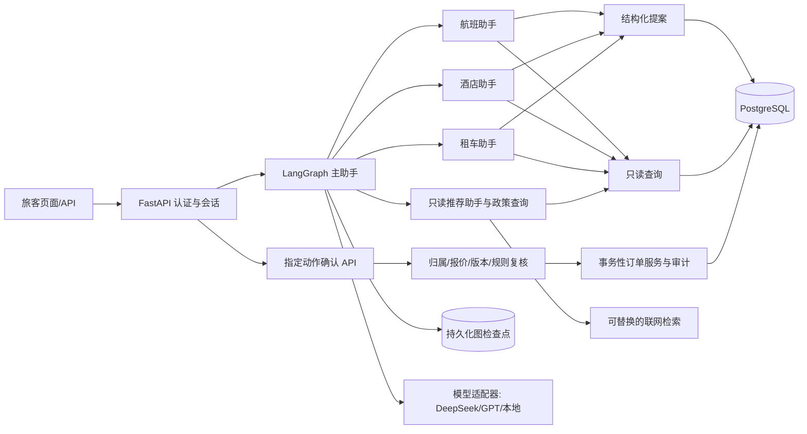

# 软件架构：旅行助手作品项目

> 版本：v0.49｜日期：2026-10-28｜状态：正式云端镜像完成短时入口复验；完整对话验收在机场酒店地点解析处暂停，修复待云端发布，公网代理关闭；自动异地留存待 P3.4c3c2

## 1. 原则与当前基线

保留 Python、FastAPI、LangGraph 主助手委派航班/酒店/租车及推荐专门助手的结构，按单体服务和清楚的模块边界实施。新图保留旧图适用的用户能力，不复用旧 SQLite 写工具、客户端旅客 ID、文本 `y` 确认或进程内检查点；游览写功能已由用户明确取消。PostgreSQL 保存正式产品、订单、会话、待确认动作和审计；本机 Docker 与未来云端使用相同迁移与业务规则。DeepSeek 为主模型，GPT 与本地兼容模型通过适配器接入。简单页面用服务端模板与少量 JavaScript，API 保持 JSON 契约。

服务端身份/会话、九类结构化提案、逐笔确认、事务结果和审计，以及全航线、可达城市酒店/租车产品、航班新预订、租车预订/改期/取消、酒店退款 v4，均已进入主线。新版受控对话图、PostgreSQL 检查点及九类对话提案也已进入主线。P2.6d 隔离评估发现的真实航司政策分流、待确认卡撤回、候选短序号和口头同意问题，已在 P2.6e 修复并经受限真实 DeepSeek 定向复测。旧 SQLite 写工具、未注册的旧图与用户接口在 P3.2a 剥离，并随 P3.2 发布。P2.7 人工核实地点目录覆盖 95 座可达城市，已随主线发布。P3.1 旅客页面、中文展示、多轮查询与待确认交易、有限证据推荐、流式交互和会话恢复均已进入主线。具体实现状态以《当前进度》为准。

## 2. 组件与信任边界

模型和外部网页内容都处于不可信边界。模型可调用只读工具、建立待确认提案，不持有订单写服务或确认接口的工具权限。确认请求必须来自已登录旅客；服务端从令牌绑定旅客、会话与动作，模型参数或客户端传入的旅客 ID 不可覆盖。联网结果只作为带来源的信息数据，不能成为交易规则或工具指令。

**P3.1f4 页面提案路径**：查询页与最新对话引用只把候选标识、所见单价／报价版本及旅客选择的地点、日期、当地取还车时刻传给 `POST /api/v1/sessions/{id}/candidate-proposals`。API 先核对令牌对应的会话，再按相同地点和日期重新查询候选并比较单价／版本，最后调用既有 `create_proposal` 核算规则和可售状态；返回的只是待确认卡，确认接口仍独立。相同待确认提案可复用，旧卡被拒绝、过期或报价变化时不会被当作有效订单。`GET /api/v1/sessions/{id}/references` 只向会话所有者返回最近已完成轮次的结构化引用，供页面刷新后恢复选择入口；对话历史和检查点仍由原服务分别管理。页面只用 `textContent` 渲染外部文字，候选 ID 与报价不构成信任依据。

**P3.4a 本机容器路径（本机主线）**：`Dockerfile` 将 FastAPI 页面与服务制成非 root 运行的应用镜像；`compose.container.yaml` 在独立项目内运行 API 和 PostgreSQL，数据库只在 Compose 网络内可见，API 仅映射本机回环端口。`backup`、`init` 处于显式 `setup` profile，不随普通 `up` 执行。`init` 只接受 `db:5432`、空数据库、可读的迁移前备份及明确的演示日期；迁移和虚构样本导入成功后，将批次日期、样本哈希、供给摘要及迁移版本写入单独命名卷。应用启动时核对该清单与数据库，正常重启只读不导入；`/health` 表示进程存活，`/ready` 读取数据库演示状态。地点目录校验仍需读取镜像内 5.2 MB 的脱敏虚构航线样本；原始 SQLite、配置密钥和备份被构建排除。该路径目前只用于隔离验收，现有本机 8000→5436 专用入口保持原样；云端域名、HTTPS、密钥托管和费用边界另拟 P3.4b／c。

**P3.4b 云端架构（已完成短时公网验收）**：`compose.cloud.yaml` 单独编排 PostgreSQL、FastAPI、Caddy 和一次性初始化／账号管理容器。公网仅发布代理的 80／443；API 与数据库留在容器网络，应用进程继续以非 root 账号运行。域名、HTTPS 来源、模型和联网密钥、镜像摘要来自专用 Git 忽略文件，缺项时启动守卫拒绝提供服务。云端初始化沿用空库备份、完整迁移、虚构供给导入和批次清单；普通重启只核对清单。初始 `demo1`／`demo2` 账号须停用，并创建单独授权账号后才允许云端应用启动。单实例请求限制约束登录失败、每账号对话频率与并发；模型和搜索仅记录调用结果类别及可得的 token 数，不保存提示词或响应正文，用量金额以服务商账单为准。余额不足给出明确错误；交易依旧由服务端逐笔确认。P3.4c2f 已完成受信 HTTPS、授权账号和真实模型／搜索的短时验收，结束后按展示习惯停止应用与代理，仅数据库运行。本机 8000→5436 不随其改动。

**P3.4c3a 手动异地恢复边界**：原云端新建 `pg_dump -Fc`，连同独立批次清单和不含凭证的摘要封装，经已核验 SSH 通道在旅客本机直接加密，恢复私钥不进服务器。实际从该本机密文解密，在另一 Compose 项目、全新数据库／清单卷和内部网络恢复；先比较源库与恢复库摘要，再只启无宿主机端口的私有应用核对授权账号。恢复环境使用独立数据库与 JWT 密钥、不可调用的模型／搜索占位配置；演练结束停止容器并删除临时明文，保留新卷和本机密文。该检查点证明一次手动恢复，自动每日备份、不同地域 OSS 与留存策略尚未落实。

**P3.4c3b 隔离交易与对话边界**：从服务器外密文另建可写副本，独立验收九类交易、并发与重启；真实模型多轮暴露的“不要下单”误出卡和取消历史误出卡，在功能分支修复。最早航班路由只依据服务端确认的写意图决定是否建卡；服务端对带明确否定或历史查询语义的模型提案再设一道拒绝边界，同时允许“选最贵车辆”“生成酒店确认卡”等经上下文限定的自然表达。修复文件仅临时装载到无公网端口的隔离应用，11 轮确定性重放通过后停止并清理；原正式镜像没有因此更新。正式发布须重新构建镜像、备份、受控短时上线及回退核对。

**P3.4c3c1a 只读意图统一守卫**：`dialogue_context.is_read_only_action_request` 分句区分否定写入、只读询问和独立明确写入；`requested_actions` 与旅客 API 落卡入口共享该判定。受控图在本轮明确否定时将旧任务的预订目标降为探索，但保留可核实路线／日期；历史查询优先于继承的最早航班任务。`agent_reads` 仅从数据库排程换算两端机场当地时刻。联网能力问句与“请联网核查地点”的推荐请求分别路由；搜索结果仍须通过来源核验，资料不足可回退人工目录。以上均不增加数据库迁移、对外路由或模型确认权限；代码仅在独立卷与无公网端口应用中完成真实复测，正式云端镜像仍待发布。

**P3.4c3c1e 机场地点边界**：对话提取到“伦敦希思罗机场”等已知机场名时，将旅客地点拆成城市 `London` 与机场 `LHR`，酒店和租车查询保留机场范围；旅客明确改为仅查城市时清除旧机场范围。酒店只读查询收到单独的三字机场代码时，再从数据库核实其所属城市，避免把机场代码误当城市查出虚假“无产品”。这一修复不改交易确认规则或数据库结构；正式云端镜像仍待复验。

**P3.4c2d 非公开云端预部署（历史检查点）**：当时确定根域为主站，`www` 在代理配置中跳转到根域；Caddy 语法已在无网络一次性容器中验证。服务器上保存经提交哈希追溯的代码包、权限收紧的独立私有配置与固定摘要基础镜像，应用／初始化／账号管理三张镜像已构建并通过依赖与私有文件隔离检查。该段记录的是数据库初始化与公网验收之前的状态；其后续结果以 P3.4c2e、P3.4c2f 和 P3.4c3a 验收记录为准。

**P3.1h3 对话候选边界**：航班、酒店、租车候选分别记录查询地点、日期及产生时刻；隐含指代只在同会话、同类任务且 15 分钟内复用。旅客本轮明确的业务类型约束模型建议的写动作及附带查询，模型不能用租车话语调用旧航班候选。自然取还车时刻只取旅客文字，酒店“两晚”在已唯一核对的航班当地到达日上计算；最终交易仍由服务端重查报价、规则和本人归属，再生成逐笔待确认卡。隔离页面验收入口另对付费模型与搜索调用设置次数和估算费用停机线，流水只存 Git 忽略目录。

**P3.1e5 排程规则**：落地酒店依赖航班 `arrival_at` 换算的目的地当地到达日。导入时由 `travel_assistant/services/flight_schedule.py` 计算机场坐标的大圆距离，按 `fictional-flight-time-v1` 生成确定性时长：35 分钟固定准备时间，按距离的 1.05 倍、每小时 820 公里计算，向上取整至 5 分钟，并限制在 45 分钟到 24 小时。它只提供可信的虚构展示排程，不代表真实航司时刻或运营预测。出发时间、航班 ID 和报价不变；源实际到达相对源计划到达的偏差随新计划到达平移。计划与实际时间均为统一时刻存储，页面按机场时区显示。模型和实时搜索均不能改写排程。

航班可订出发日仍止于演示基准日后第 30 日。跨时区航班最晚可在第 31 日落地，因此每机场至少一种酒店房型的有效退房日扩至基准日后第 34 日；其他房型保留不同可用窗口，价格种子继续使用原规则以避免无关报价变化。酒店查询日期边界单独扩至第 34 日，租车仍按原第 31 日边界。批量审计须比较全部航班和报价，并检查每条可售航班的落地日起两晚酒店覆盖。重建正式库会清除旧演示会话、卡片和订单，须单独备份、核对并确认。

P3.1e6 在正式库显式重建后复用同一全量审计；审计脚本默认只允许隔离库端口 5434，正式库端口 5433 须显式加 `--formal-read-only`，两种模式均不写数据库。临时旅程验收账号和卡片从正式库清理后，核对所有业务与审计计数恢复到重建后的基线。备份只存本机 Git 忽略目录。

## 3. 模块职责

- `travel_assistant/api/`：认证、会话轮次、订单/产品查询、提案确认与历史；负责请求校验和身份绑定，不直接执行订单 SQL。
- `travel_assistant/agents/controlled.py`：受控主助手的意图分流和任务状态；查询与提案由业务服务完成。旧图文件已在 P3.2a 移除。
- `travel_assistant/services/`：承担只读查询、结构化提案、身份授权、模拟价格/政策、产品可用性、订单事务、审计、推荐证据整理和距离计算；不再使用旧 `tools/` SQLite 写封装。
- `travel_assistant/services/answer_composer.py`：只读答复的可选呈现层。模型只选择版式和服务端预设提示；原事实文本、引用及动作状态不由模型改写。模型不可用时保留确定性答复。
- `travel_assistant/db/`、`migrations/`：正式航班/酒店/租车产品与订单、会话/动作/检查点、约束、迁移和种子；迁移版本仍在项目根目录，不建游览产品、场次或订单表。
- `tests/`：自动化按 `business/`、`dialogue/`、`recommendations/`、`interface/` 分组，`support/` 保存页面替身；原 `unittest discover -s tests` 入口保持。
- `scripts/`、`data/fixtures/`：现行迁移入口、全航线样本生成与显式导入、整体时间平移、报价及酒店/租车产品核验。P3.2b1 已移除旧小样本重建链；P3.2b2 已移除一次性评估入口；P3.2b3 将有价值的旧故障与推荐恢复断言迁入自动化后，移除过时的专项核验入口。[脚本入口索引](../../scripts/README.md)区分只读、数据库写入和可能付费的命令。旧 5434 隔离旅程脚本保留作历史重启验收参考，暂不作为日常命令。
- `travel_assistant/paths.py`：从应用包位置定位项目根目录、交付样本与页面资源，不依赖启动时的工作目录。
- `travel_assistant/web/static/`：同源轻量旅客页面；`main.py` 继续通过 `/app` 和 `/static/*` 提供，展示模型答复、来源、卡片、状态和订单。
- `travel_assistant/core/`：模型/检索提供方、超时、限额、数据库环境配置，以及密码哈希、数据库会话依赖、CORS、异常处理和日志配置；从项目根目录加载 `.env`，密钥不进入源码、日志或 Git。

## 4. 数据设计与完整航线导入

沿用正式旅客、机场、航班、机票/酒店/租车订单、规则、会话、动作及审计实体；推荐来源 URL、检索时间和证据可随对话轮次保存，是否另建检索元数据表在 P2.7 计划中审定。产品与旅客订单分开；订单有所有者、状态和版本。取消保留订单与审计，不物理删除。旧 `update_excursion` 直接修改共享推荐资料，新图不接入任何游览写工具，也不创建游览产品、场次、库存或个人游览订单。

原虚构库约有 33,121 班航班、115 个机场、618 条航线。提取全部航线及必要的航班/机场字段，过滤个人信息，生成可交付压缩样本或确定性导入工件；不要求新环境持有原 114 MB 大库。导入时用同一时间差平移出发、状态边界与相关订单时间，再按版本化规则计算到达；正确处理机场当地时区和到达日。未来约 30 天的可预订班次才参与搜索和报价；历史、取消与延误记录按状态处理。发布前验证航线覆盖率、时间窗、机场外键、无效日期与演示订单关联。重置机制须避免在有真实演示操作时静默覆盖订单，明确提示其为演示环境重建。

**P3.3 分步实施的生命周期边界**：旅客已选择用独立数据库项目和数据卷生成新演示批次，原库及其订单、会话、动作和审计保持原样供回退；新批次重新生成虚构供给和初始订单，不跨批次合并旧记录。P3.3a 已完成[只读预检与切换手册草案](P3.3a-演示批次安全预检记录.md)，P3.3b 已完成[两套隔离批次的构建与验证](P3.3b-隔离演示批次验收记录.md)，P3.3c1 已完成[5438 独立页面验收](P3.3c1-隔离页面全旅程验收记录.md)，P3.3c2 已按[验收记录](P3.3c2-正式入口切换验收记录.md)将本机 8000 显式指向 5436。启动守卫核对数据库身份、批次日、迁移和供给摘要；旧 5433 卷与恢复演练结果保留。当前代码仍使用单个 `demo_state` 和显式重置命令，尚无自动批次切换能力。

模拟报价由稳定输入和版本化算法生成，不让模型定价。酒店/租车产品按可达城市、位置、日期和有限可用量生成，产品名称明确为虚构。候选查询有日期/城市索引和分页/数量限制；对话默认最多展示三个符合条件的航班。没有相应班次或产品时返回“没有可预订结果”，不以生成式内容补齐。

P3.1a 的旅客展示目录由 `travel_assistant/services/location_labels.py` 统一维护：原 95 座可达城市中文别名供推荐解析继续使用，另补齐 11 座来源城市的展示名，并为 115 个机场给出确定性中文显示名。同城多机场采用可区分名称；登录后的只读 `/api/v1/locations` 从当前数据库机场行返回原代码、英文城市、中文显示名和时区。页面按中文选择后仍向原查询 API 发送规范代码／城市值，交易服务不接收展示名代替标识。原整数示例金额在页面和确定性答复中按 `¥` 与千分位显示；`/api/v1/demo-state` 标注展示币种 `CNY`，订单／报价数值及确认核算保持原样。未知名称安全回退原值，不推测实际机场或价格。

## 5. 政策与动作协议

原 `order_faq.md` 经过去品牌、冲突清理后转成版本化虚构平台政策。规则记录 ID、版本、生效范围、条文、可机器计算参数。系统用于交易的政策来自规则表；政策检索仅解释规则，不能替代服务层校验。已确定：航班改签只补/退票价差，取消收原价 30%；租车原取车前可保持车辆不变改期，按新旧总价补退差额，无改期费；原取车前取消模拟全退，到取车时刻后不得改期或取消；酒店在产品机场当地入住日期前取消模拟全退，入住日起禁取消，同日仍可预订或改期。酒店规则为 v4，v3 留作历史审计；租车改期规则为 v3，v2 留作历史审计。确认时重新按当地时间、订单金额及政策版本计算，旧卡失效。真实航司政策只可作为带来源的外部参考，不能决定模拟订单交易。

提案服务校验产品、旅客和规则，保存规范化参数、旧/新快照、模拟价格、规则版本、有效期、会话与幂等键。确认服务在单笔事务中重新检查身份、归属、状态、时间、订单版本、报价和可用性，执行一笔业务状态变更与审计。拒绝/过期/价格变化使旧卡失效；重复确认返回既有结果。模型文字、网页文字和通用文本 `y` 均不能确认动作。

## 6. 多轮模型与检查点

新轮次接口以已验证的服务端会话 ID 作为图线程边界，`chat_messages` 保存页面历史，PostgreSQL 图检查点保存内部运行状态。两者通过会话和请求幂等标识关联；进程重启可恢复，演示重置同步清理。模型调用期间不持有订单事务锁。轮次失败必须清楚呈现，不得说已执行；工具调用重试不重复生成卡片。

模型适配器统一消息和结构化工具调用接口，设置超时、单轮工具步数/结果量、并发与费用限制。政策回答须先取得正式规则证据，再核对规则 ID、版本与关键结论；订单状态、价格和候选班次等事实须能对应工具结果，无法核对时不输出肯定断言。DeepSeek 是真实演示的主路径；GPT 和本地模型可切换，但本地模型须通过工具调用能力验证才能提出交易动作。没有配置密钥时，健康检查及非模型 API 可继续工作，对话返回明确配置状态。用户在实际模型测试前按说明把 API 密钥写入 Git 忽略的本机 `.env`，不在聊天中发送。

P3.1d 的 `travel_assistant/services/dialogue_context.py` 在服务端规范化中文地点、机场及相对日期，把最近只读任务的明确条件存入会话图检查点；交易提案仍走原来的参数白名单与确认协议。`travel_assistant/services/agent_reads.py` 合并同城机场搜索，区分未知地点、日期窗、无直达航线和指定日无班次，并区分当前有效行程与明确请求的历史订单。航班和酒店的组合只读请求可在一轮分别查询；跨轮补足酒店日期后重新汇总。相对日期按当前中国日历日解析，演示供给日期窗仍由正式库 `demo_state.as_of` 限制，超窗如实告知。模型负责意图路由，订单、班次、价格和天气事实由受控服务生成，答复目前仍采用确定性事实模板，不把自由生成文字当作事实依据。

P3.1e1 将明确的交易表达在只读捷径前识别，并按业务任务在图检查点保存已展示候选及其日期、地点、报价版本。新租车话题不继承酒店查询条件；交易只能引用当前会话中的对应候选，服务端在建卡前比对本轮明确的地点／日期与当前报价。机票提案和酒店只读查询可同轮返回，酒店查询条件不足不会撤销正确的机票卡。客户端收到的引用仍维持原有公开字段；任务范围信息只留在服务端检查点。重复请求键沿用既有轮次幂等协议，订单写入仍只经过单笔确认接口。

P3.1e2a 在 `travel_assistant/services/travel.py` 提供跨日期有界航班查询：按出发机场当地日历计算各自窗口，合并全部起终点机场组合，在数据库按 UTC 起飞时刻排序、截取前三条，并另计同一最早时刻的并列数。只取状态可售且带有效报价规则的班次，起飞须晚于当前时刻；唯一最早目标由受控查询给出，模型 JSON 不得决定目标。`dialogue_context` 只在航班任务延续日期下界，新路线清除旧日期；对话图保存本轮候选及唯一最早标记。`travel_assistant/api/travel.py` 创建对话提案时启用同会话卡片复用；`travel_assistant/services/actions.py` 在当前重新报价后核对规范化参数、目标订单版本、前后快照、金额、规则及报价版本与有效期。此复用为对话入口的体验规则；直接提案 API 保持原有并发提案行为，确认服务仍独立复核每张卡。

P3.1f1 在原有图检查点的 `task_contexts.flight_search` 保存旅客提供的路线、日期／下界、最早偏好、订票目标与字段来源，跨话题按业务域恢复；显式换目的地时清理旧日期、偏好和目标。`candidate_scopes.flight` 记录查询路线、日期、排序、下界及观察时刻；引用候选时要求当前任务条件相符且未超过 15 分钟。当前任务已改或候选过期后，服务端拒绝沿用旧编号／“前面那班”建卡。新订机票时，模型建议的航班查询条件须由当前已核实任务覆盖，不能把编造的另一条航线带入建卡；改签仍由本人旧订单与同航线约束核验。图内存回顾节点仅使用这些有界字段，并通过本人会话的动作读取接口复核卡片状态；模型不可用时仍可回答该受控回顾。模型继续承担一般意图识别，交易对象、报价与可售状态仍由确定性读取和建卡服务核对。日志只记录意图、字段名和候选数量，不记录字段值、完整对话或密钥。

P3.1f2 保留 `/api/v1/me/itinerary` 返回本人各状态订单的完整只读契约，并由 `travel_assistant/services/itinerary_state.py` 按实际时刻、酒店当地日期及订单状态附加 `display_state`。`agent_reads` 对普通当前行程只读取 `active`，明确历史查询才列 `finished`／`cancelled`；`travel_assistant/services/recommendations.py` 仅从仍有效的本人行程推断目的地。`travel_assistant/services/order_targeting.py` 用本人数据库订单、航班关联机场、酒店城市和租车取车机场核对旅客的属性描述；模型建议的订单 ID 不能越过该核对。批量取消由 `agent_feedback` 列出保留、可取消、已过截止和未生成卡的订单，每轮最多两张卡，最终确认仍经原动作事务与版本复核。页面用原生 JavaScript 将有效行程与可展开的订单历史分区；“操作记录”仍是独立的动作审计，不替代订单历史。

P3.1f3 在 `travel_assistant/agents/controlled.py` 增加受控的 `trip_discovery` 路由和会话任务：只有旅客提出未确定目的地的乘机旅行建议才进入组合查询，出发地取本会话自述或本轮明确的“从某地出发”，日期取旅客给出的日期；缺项分别追问。`travel_assistant/services/trip_discovery.py` 按各出发机场的当地日期和当前时刻筛选有效规则、正价、可售的模拟直达航班，每座到达城市保留最早候选并限制返回规模。偏好地点引用 `reviewed_places` 中近期核查的资料；明确偏好时先过滤目的地，不用其他主题补位；“自然风景”再排除室内博物馆与水族馆。实时阿里云检索仅作新鲜度尝试；天气继续使用 `weather_search` 对中国城市官方页面的独立校验，境外没有同等级校验时一律降级。原始搜索摘要不能写入答复事实或交易参数。推荐候选只保存在独立任务状态，不直接成为可下单的航班候选；旅客选城市后重新调用现有 `flight_search`，由后续明确班次及原提案服务、确认事务把关。

P3.1e2b 的 `dialogue_context` 在同一酒店任务中解析明确的住宿晚数和连续住宿日，按入住日计算退房日，并允许本轮明确退房日覆盖旧晚数；本轮晚数与明确退房日冲突则只追问。租车任务分别保存本人说出的取还日期与钟点，不用服务器或模型推断缺失时刻。酒店与租车的 `price_desc` 只读查询先按完整地点／日期条件筛选全部有效产品，再排序和截取；对话查询另计并列最高／最低，只有唯一目标才把受控选择标记留在会话候选中。提案服务比对酒店日期与本轮候选、租车每一端日期／钟点与该任务的明确条件；产品机场的 IANA 时区转换、夏令时校验、实际 24 小时向上计费和确认时重算仍由原交易服务负责。页面卡片补充住宿晚数、租车当地偏移、计费日数与金额。

P3.1e3a 在对话图增加独立的地点检查点状态：`current_city` 只来自旅客明确自述，`destination_city`、`arrival_airport` 和 `arrival_date` 来自有结果的航班查询。航班查询额外把实际机场与当地到达日作为**内部候选详情**交给检查点，公开引用字段保持原契约。落地酒店在读取时再次按航班 ID 核对可售状态、到达机场和当地日期；没有当前候选时，只可回退到本人唯一未来已确认的机票，多候选要追问；新的航班查询清除旧的落地酒店建议。到达日入住建议与用户明确接受的日期分开，缺住宿日期不建酒店卡。`find_hotels` 的已有机场坐标距离仅在坐标齐全时展示为近似直线距离。推荐助手可从受控地点状态接收已解析城市，仍只输出人工核查目录事实，联网结果不参与地点距离或交易。有效行程读取按当前时刻筛选已确认且尚未完成的订单，历史查询保留已取消记录。新增图节点只扩展既有检查点字典，不增加数据库迁移或跨账号共享状态。

P3.1g1 增加 `task_contexts.country_flight_search`，仅保存本会话的出发地及来源、国家代码、日期下界、订票目标、最多五个受控城市选项和 15 分钟观察时间。`travel_assistant/services/country_flights.py` 先用受审机场地理资料校验国家、城市及时区，再在当前 `demo_state` 窗口用数据库窗口函数按目的地城市选最早正价可售直达航班，按 UTC 排序后限制输出量；“明天”按出发机场时区换算。选城路由转为原 `flight_search`，重新查询唯一最早班次；原选项的航班、金额、报价版本须与新查询相符，才把本人会话内的预订目标交给既有提案服务。并列、改价、过期或改口均不复用旧目标。国家选项不是可直接确认的订单对象；实际订单仍由独立确认事务创建。本步没有新迁移、页面接口或外部模型／搜索依赖。

P3.1g2 复用 `itinerary` 的本人订单查询和 `display_state` 过滤；`travel_assistant/services/agent_reads.py` 对当前行程统一构造各业务的中文完整简报、按开始时刻排序、最多显示六笔并说明其余数量，引用只对应已显示的本人有效订单。`travel_assistant/agents/controlled.py` 扩展自然回顾和“周围”地点词形；回顾只从有界会话任务和经本人会话核验的动作卡读取，待确认卡与有效订单分开陈述。`location_context.current_city` 仅由旅客自述产生；推荐路由在自述城市与航班目的地冲突时澄清，只向原地点服务传可核对的城市，并在当轮答复注明自述来源。临时 `nearby_city` 每轮清空，防止新话题误沿用。模型信息只显示配置提供方与标识及其证明边界，不公开密钥或内部服务地址。本步不新增迁移或交易接口。

**P3.1h1 流式回合**：保留原 `POST /sessions/{id}/turns` JSON 接口，新增 `POST /sessions/{id}/turns/stream`，两者复用 `_process_turn`：本人会话校验、请求键幂等、图检查点、证据与提案核对、最终答复和卡片提交完全相同。同步图调用在线程池中执行，独立数据库会话不跨越请求依赖作用域；并发槽位有限。流式接口按 SSE 格式依次发 `progress`／`accepted`、核验与提交后的 `delta`、`completed`，失败则发 `failed`；连接断开不会中止已开始的受控回合事务。代理禁缓存与缓冲，12 秒无事件时发送心跳。所有事件为版本化 JSON，不含密钥、未经核实的模型文字或内部推理。此处的流式仅指**已完成答复的分段呈现**，不会提前透出候选、金额或订单成功宣称。

页面 `fetch` 带本人令牌和请求键读取 UTF-8 字节流，按 SSE 帧解析，使用 `textContent` 追加最终文字；先立即画出用户气泡及真实等待状态。会话修订号阻止旧流画进新会话；`GET /sessions/{id}/turns/{request_key}` 和 `/sessions/{id}/turns/status/latest` 供断线、刷新、切换会话后的本人状态核对。完成时重新读取持久消息、来源和卡片；失败回合复用同一键重试而不追加用户消息，租期内处理中的回合不能并行重跑。境外天气仍按当前覆盖限制降级，不新增境外来源适配器。

P3.1h4b 页面刷新续接把短期访问令牌及当前会话 ID 仅保存在同源当前标签页的 `sessionStorage`；页面重新加载时先用令牌请求 `/api/v1/me`，通过后才恢复会话、消息、卡片和最近回合状态。密码不持久化，退出、401 或账号停用时清除标签页记录；暂时断线时保留令牌供刷新重试。服务端仍以令牌和数据库本人归属为唯一权限依据，不信任保存的会话 ID。该方式便于本机演示的标签页刷新；未来公开部署应单独评估 HTTPS、HttpOnly 会话续期及脚本注入防护，不把当前页面存储视为完整生产认证方案。

## 7. 联网推荐与证据

推荐检索采用可替换的提供方接口；首个真实适配器接入阿里云 CleverSee 国际版 `GlobalBasic`。只对当前模拟航班可达城市给出经典地点推荐；城市和国家先由受控机场代码、城市、时区与随仓库交付的 IANA 时区映射校验，无法唯一确认时不检索。搜索只发送城市、国家和主题，不发送旅客信息；摘要增值项关闭。P2.7c 的全城抽查证明实时搜索标题与摘要不足以稳定判断具体地点和来源可读性，所以后续以人工核实、可版本化的地点目录作为事实基线，实时搜索只用于补充和新鲜度检查。对话正文可只介绍地点与理由，结构化引用保留来源和审查时间；不设游览产品浏览页。酒店到景点的“附近”仅在有可信坐标时计算直线距离，不能写成驾驶/步行时间。不可达城市返回覆盖范围说明和可达替代城市；联网结果不能进入交易产品或规则表。

P3.1e3c 的 `reviewed_place_display_v1.psv` 按稳定 ID 覆盖全部 190 条原目录地点；`travel_assistant/services/reviewed_places.py` 先校验原 v1/v2 一致性、可达城市和来源，再校验中文展示表的一对一映射、证据 URL、主题与同城唯一名称，最后合并为只读记录。原 `name`、别名和来源保持不变；展示类别和可选中文简介来自审查表。`travel_assistant/services/recommendations.py` 用中文名及原名构造正文，API 引用只追加 `display_name` 和展示审查日，原 `place`、`title`、`url` 与审查日保持兼容。中文地点指代只在静态目录中唯一匹配时解析城市；跨城市冲突要追问。页面引用以中文名为主，仍保留原名。名称证据等级及复核记录见[地点中文展示审查记录](地点中文展示审查记录.md)。

外部网页可能含提示注入；搜索摘要只进入受限的证据字段，不赋予工具调用权。无来源或证据冲突时说明无法核实，不补写开放时间、票价或实时交通等事实；无网络/密钥/额度时返回清楚的降级结果。航班政策问答使用内部规则优先，不以网络搜索替代交易规则。P2.6 先完成对话与交易接入；P2.7 用固定检索结果验证推荐流程，再用用户配置的有效密钥做实际联网联调。

用户要求联网搜索默认开启：P3.1c 已把有密钥时的代码缺省值改为开启，仍可用 `.env` 显式关闭。即使开启，也只在有已核查地点的可达城市推荐中尝试检索，回答事实仍来自版本化人工目录，搜索失败继续回退。联网状态记录不含密钥；服务商费用由其账单核对，不放宽证据或交易边界。

P3.1d 的天气路径先向 `GlobalBasic` 发送公开城市及目标日期，不发送本人订单或对话；只对白名单内国家气象中心 HTTPS 页面重新取回正文，核对城市、日期、发布时间和温度，搜索摘要不直接作为预报。中国五座可达城市设置已核对的官方页面回退地址；联网搜索失败、页面过期、非目标城市或无法核验时明确降级。天气引用包括官方页面和检索时刻，不赋予网页指令或交易工具权限。该路径只覆盖未来七天内的中国可达城市，并非通用全球天气服务。

## 8. 验证、交付与阶段门槛

先用固定模型输出验证多助手路由、政策依据、澄清、逐笔提案和异常；推荐阶段再用固定检索证据验证来源引用。配置有效密钥后，用少量 DeepSeek 真调用测试任务完成率和幻觉。重点验证不存在航班、过期价、伪造政策、越权订单、提示注入、未确认宣称成功、搜索失败与恢复重试。业务服务测试与 API/数据库实测覆盖现有九类写入、重复确认和并发。页面须可重现固定演示脚本，README 提供重置、启动、配置、成本与故障排查步骤。

后续路线及独立开工门槛见《操作计划/R-01-后续阶段总路线.md》；每阶段的实际结果只记《当前进度》。本机 Git 合并和远端推送分别制定并确认计划。
