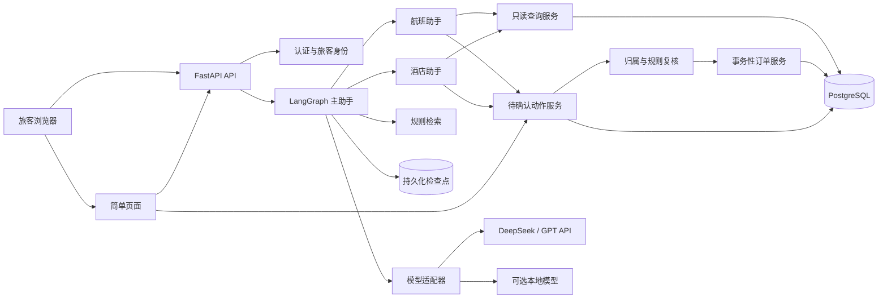

# 软件架构：旅行助手作品项目

> 版本：v0.2｜日期：2026-10-17｜状态：目标架构，P0 实施中

## 1. 设计原则

保留当前 Python、FastAPI、LangGraph、多助手委派、业务工具的核心框架；把身份、业务规则和数据库写入从模型决策中分离。优先单体服务与清楚的模块边界，不引入微服务、消息队列或额外后台。先让本机演示可重复运行，再用相同应用结构部署云服务器。

## 2. 当前代码事实与差距

| 现状 | 依据 | 目标 |
| --- | --- | --- |
| FastAPI 提供用户和图调用 API | `main.py`、`api/routers.py` | 保留入口，整理版本化 API 与身份依赖 |
| LangGraph 主助手委派给航班、酒店、租车、景点助手 | `graph_chat/finally_graph.py`、`graph_chat/build_child_graph.py` | 保留委派结构；首阶段完整建设航班与酒店闭环 |
| `MemorySaver` 仅在进程内保存会话 | `graph_chat/finally_graph.py` | 持久化检查点，支持刷新和重启恢复 |
| 客户端可传旅客与线程 ID | `api/graph_api/graph_schemas.py` | 旅客身份从登录令牌解析；线程与旅客由服务端绑定 |
| 酒店表的 `booked` 表示预订状态 | `tools/hotels_tools.py` | 建立独立酒店产品和旅客订单，不用全局酒店布尔值充当订单 |
| 旅游业务使用 SQLite，用户模块使用另一套数据库配置 | `tools/__init__.py`、`db/__init__.py` | 统一交易数据模型、连接管理和迁移 |
| 图在敏感工具前中断，接口用文本 `y` 继续 | `graph_chat/finally_graph.py`、`api/graph_api/graph_views.py` | 结构化确认卡、动作 ID、逐笔授权、过期和一次性执行 |
| 依赖和启动信息未形成可复现交付 | 当前仓库文件清单 | 固定依赖、配置示例、迁移、演示数据和启动说明 |

已有的 `security_best_practices_report.md` 与 `ctrip_assistant_codex-threat-model.md` 是实施时的风险清单；其中关于源码凭证、对象授权和用户管理越权的问题在对外展示前必须处理。旧代码与数据库尚未证明能直接在全新环境运行。

## 3. 目标组件

界面建议使用 FastAPI 服务端模板和少量原生 JavaScript，足以实现聊天、订单展示与确认卡，避免首版引入独立前端工程。API 仍提供清晰的 JSON 契约。业务数据库建议统一 PostgreSQL，本机通过容器启动，云服务器复用同一迁移和配置；它既保存订单和审计，也可承载持久化会话检查点。开发时可以有轻量测试数据库，但不得让演示和云端使用两套不同的业务规则。

## 4. 模块边界

- `api/`：请求校验、认证依赖、会话和动作端点；只编排，不直接执行订单 SQL。
- `graph_chat/`：主助手、航班／酒店专门助手、状态与路由；负责理解意图、查询和提出**结构化动作**。
- `services/`（拟新增）：旅客授权、行程查询、规则判断、待确认动作、订单事务与审计。确定性的关键规则放在这里。
- `db/`：模型、会话、迁移和仓储查询。所有订单写入走同一事务边界。
- `tools/`：供智能体使用的薄工具封装；只读工具访问查询服务，写工具只能创建待确认动作，不能直接更新订单表。
- `templates/`、`static/`（拟新增）：简单操作页面及少量脚本。
- `config/`：环境配置与模型提供方选择；密钥从环境变量注入。

这是一份目标结构，不要求一次性大搬迁。已有租车和景点助手保留在图设计中，第一阶段可暂不对页面开放其写能力，后续复用动作服务。

## 5. 数据与状态设计

建议的核心实体：`users`、`traveler_profiles`、`flights`、`flight_orders`、`hotels`、`hotel_products`、`hotel_orders`、`policy_documents`、`pending_actions`、`audit_events`、`chat_sessions`。精确字段在实施阶段以迁移文件和 API 契约为准。

- 订单始终有所有者、状态、版本、创建／更新时间。酒店产品与旅客的酒店订单分开；取消使用状态变更，保留历史。
- `pending_actions` 记录动作类型、目标订单、规范化参数、变更前后快照、发起旅客、会话、状态、过期时间和幂等键。不保存完整模型推理过程。
- `audit_events` 记录提议、确认、拒绝、过期、执行成功／失败；保留关联 ID 与必要摘要，避免把令牌或敏感原文写入日志。
- 会话检查点持久化。服务端产生会话 ID；每次读取、恢复、确认时都校验会话归属。
- P0 从旧虚构 SQLite 精选关联数据，形成可交付、匿名化的小型 SQLite 样本；导入脚本只读该样本，按运行日期生成 SQL 并载入 PostgreSQL `demo_source` 暂存结构。原大库不进入 Docker 镜像，也不是新环境的启动依赖。P1 再把暂存数据映射至正式旅客与订单模型。

## 6. 写操作协议

1. 助手调用只读工具取得真实候选数据，提出结构化动作。业务服务检查参数和订单归属，保存 `pending` 动作，返回确认卡。
2. 旅客在页面对**指定动作 ID**确认或拒绝。不得用通用文本 `y` 代替身份和动作绑定。
3. 确认接口在事务中重新核验旅客身份、动作状态、有效期、订单版本及模拟库存／规则，随后执行**一笔**业务写入和审计写入。
4. 幂等键、数据库约束及版本检查防止重复确认和并发覆盖。结果可在订单与操作历史中核对。
5. 拒绝、过期、执行失败或规则变化均不静默写入；规则变化须重新提出方案。

这满足“智能体操作增删改查、用户确认增删改内容”的要求，同时让具体写入由确定性服务执行。模型失联或回答错误不能跳过授权边界。

## 7. 模型、检索与异常

模型适配器用统一的聊天和工具调用契约配置 DeepSeek、GPT 与可选本地兼容接口。提供方、模型名、地址、超时和配额以环境变量配置，密钥不在代码或文档中。启动时或演示前验证模型能否稳定执行结构化工具调用；本地模型若只会聊天，界面可供查询体验，但不允许进入交易写流程。

政策资料使用本项目自编的演示规则，带规则 ID、版本、适用范围和来源。首版数据量小，可先用确定性检索／全文匹配，再根据评测证据决定是否需要向量检索。检索结果只提供参考，订单可否修改由业务服务复核。外部网络搜索作为可选信息工具，不能作为交易规则的唯一依据。

模型调用有超时、有限重试和明确错误反馈；服务端限制输入长度、工具结果量和并发／调用成本。失败不可自动重试已完成的写操作。时间采用带时区的表示，页面明确展示当地时间。

## 8. 部署、验证与演进

- **本机**：应用和 PostgreSQL 由简单启动配置运行；执行迁移与种子脚本后打开页面。提供环境变量示例，不附带凭证。
- **云服务器**：相同应用镜像和迁移流程，增加 HTTPS、备份、日志留存和访问限制；首版无需 Kubernetes。
- **测试**：服务层测试覆盖授权、规则、事务、幂等；API 测试覆盖跨账号访问和动作确认；固定模型输出的图测试覆盖路由与失败；少量真实模型端到端脚本用于演示前验收。
- **评估**：记录固定场景的任务完成率、误操作率、人工确认正确率、端到端耗时和模型成本。先建立基线，再设性能门槛。

官方资料：LangGraph [持久化](https://docs.langchain.com/oss/python/langgraph/persistence) 与 [中断恢复](https://docs.langchain.com/oss/python/langgraph/interrupts)；FastAPI [容器部署](https://fastapi.tiangolo.com/deployment/docker/)。具体库版本在实施时锁定和验证。

## 9. 架构决策与待确认项

| 决策 | 当前结论 | 说明 |
| --- | --- | --- |
| 交易环境 | 仅模拟交易 | 用户没有真实供应商接口；页面持续提示模拟性质 |
| 数据规模 | 小型确定性数据集 | 覆盖测试分支比数量更重要 |
| 初始数据来源 | 旧虚构 SQLite 的匿名化精选样本 | 保留来源价值；旧大库只读，日期在导入时平移 |
| 数据库 | 推荐 PostgreSQL | 统一订单与持久化状态，本机／云端一致 |
| 前端 | 推荐服务端模板 + 少量 JavaScript | 满足简单页面，保持代码量可控 |
| 模型 | 云端 API 为演示主路径，本地模型可选 | 本地工具调用能力须实测 |
| 平台名称与 UI 风格 | 尚未定 | 不阻碍业务底座实施，页面制作前确认 |
| 云服务器提供商与预算 | 尚未定 | 本机先完成；云端选型在部署阶段确认 |

