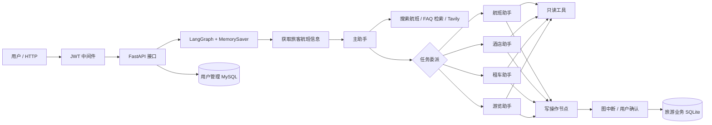

# 携程智能旅行助手项目面试准备（基于当前仓库）

> 使用方式：先练第 1、2、3 节，再按岗位方向练第 4 节。这里的“现状”只代表对当前仓库的静态核对，不代表已在线上运行或压测。没有拿到你的简历原文，涉及“我负责”“提升了多少”的句子请按真实经历替换，不能把建议方案说成已落地成果。

## 1. 先把项目讲准确

### 1.1 30 秒版本

这是一个旅游客服场景的多助手工作流原型。FastAPI 提供用户与对话接口；LangGraph 用主助手识别意图，再把改签或取消航班、酒店、租车和游览任务交给对应的专门助手。只读查询可直接执行，修改数据库的工具会在图节点执行前中断，等待用户确认。航班和旅游产品使用本地 SQLite 演示数据，用户模块另用 SQLAlchemy 连接 MySQL；政策问答从 Markdown FAQ 生成内存向量检索器。整个项目更适合描述为“可演示的业务工作流原型”，而不是完整的真实交易平台。

### 1.2 2 分钟版本（按自己的真实贡献改写）

项目的目标是让用户通过自然语言完成航班查询、改签咨询、酒店与租车等旅游服务。入口是 FastAPI 的 `/api/graph/`，请求携带文本、`thread_id` 和演示旅客 ID。图从获取旅客航班信息开始；主助手通过结构化工具调用选择自己处理搜索与政策问题，或委派给四个业务助手。每个业务助手都有独立的工具集合和返回主助手的机制。状态里的 `messages` 由 `add_messages` 合并，`dialog_state` 用栈记录当前业务助手；`MemorySaver` 按 `thread_id` 保存对话和中断点。写操作被路由到敏感工具节点，`interrupt_before` 在执行前暂停，接口收到 `y` 后恢复。

我会特别说明原型的边界：酒店、租车与游览的预订只是更新 SQLite 表中的 `booked` 字段，尚无支付、库存或真实供应商接口；内存检查点不支持可靠的跨进程恢复；请求中的旅客 ID 还没有与 JWT 身份绑定。因此，如果进入生产环境，优先做身份与资源绑定、逐笔确认及幂等、持久化检查点、交易数据模型和自动化评估。

### 1.3 一张架构图

**代码定位**：图编排见 [graph_chat/finally_graph.py](graph_chat/finally_graph.py) 与 [graph_chat/build_child_graph.py](graph_chat/build_child_graph.py)；状态见 [graph_chat/state.py](graph_chat/state.py)；接口见 [api/graph_api/graph_views.py](api/graph_api/graph_views.py)；工具见 [tools](tools)。

### 1.4 现状与边界速查

| 话题 | 当前代码可支持的说法 | 不要这样说 |
| --- | --- | --- |
| 多助手 | 一个主助手加四个业务助手，靠工具调用和条件边路由 | 模型能稳定处理任意复杂并行任务 |
| 人工确认 | 写工具节点配置了 `interrupt_before`；接口用 `y` 恢复 | 已有逐笔、可审计的生产级审批 |
| 会话记忆 | `MemorySaver` 和 `thread_id` 保存图状态 | 已有持久化分布式会话存储 |
| FAQ | Markdown 分块、嵌入、NumPy 内积 Top-2 | 已有大型向量库、重排器、可信引用链 |
| 订单 | 旅游工具对演示 SQLite 做查询或更新 | 已接入携程、航司、酒店真实交易 API |
| 身份 | JWT 登录与中间件校验已写；航班写工具检查传入旅客 ID 对机票的归属 | 旅客 ID 已和登录用户做可信映射 |
| 指标 | 仓库未见可核实的评估、压测结果 | 准确率、延迟、转化率有具体提升数值 |

## 2. 面试官最可能连续追问的 12 条主线

每条按“首问 → 追问 → 再追问”练习。回答时先说当前实现，再说边界和下一步，不用为原型缺陷编造已上线方案。

### 链 1：项目全链路

**问：用户说“把机票改到明天下午”，系统怎么走？**

答：`/api/graph/` 把用户消息和配置传给图。图先查询当前旅客航班，主助手根据工具调用委派给航班助手。航班助手用 `search_flights` 查候选航班，必要时调用 `update_ticket_to_new_flight`。该调用被路由到敏感工具节点，图在节点前暂停；用户确认后恢复，工具检查新航班、三小时限制、机票归属，再更新 `ticket_flights`。

**追问：为什么不是主助手直接改？**

答：主助手只绑定通用查询与委派工具，写操作只暴露给相应业务助手，减少可调用工具范围，也让每类业务有独立的提示词和路由。这里的权限边界主要是工作流和工具绑定，仍需在后端建立真正的授权边界。

**再追问：用户拒绝或改口会怎样？**

答：当前 HTTP 实现把非 `y` 当成新消息继续送入图，但没有显式的“拒绝本次待执行工具”状态迁移。我会把待审批的工具名、参数摘要和审批 ID 固定在服务端；拒绝时取消该待执行动作，重新规划，而不是仅依赖输入文本约定。

### 链 2：LangGraph 状态与路由

**问：`State` 存了什么，为什么要 reducer？**

答：`messages` 是消息历史，`add_messages` 负责追加和按消息 ID 合并；`user_info` 存查询到的航班信息；`dialog_state` 是当前业务助手栈，`update_dialog_stack` 支持入栈和 `pop`。这样每轮新消息可以回到尚未结束的业务助手。

**追问：子助手如何退出？**

答：子助手可以调用 `CompleteOrEscalate`，条件路由进入共享的 `leave_skill`，弹出 `dialog_state` 并回到主助手。代码只处理最后一条消息中的首个工具调用，尚未完整处理同一轮多个工具调用。

**再追问：为什么 `route_to_workflow` 看栈顶？**

答：因为图每轮都先经过 `fetch_user_info`，要依据上轮保存的状态决定回主助手还是继续未完成的子任务。栈顶表示当前控制权；复杂并行任务需要更显式的任务状态，而不能只靠单一栈。

### 链 3：安全工具与敏感工具

**问：为什么查询和写入要分开？**

答：查询不改变业务数据，写工具可能改签、取消或修改预订，因此分成两类节点。每个业务助手通过工具名路由：全部是查询工具时走安全节点，否则走敏感节点。编译图时对四个敏感节点设置 `interrupt_before`。

**追问：模型一次调用多个工具会怎样？**

答：现有路由用 `all(...)` 判断，混合调用会整体进入敏感节点，但该节点只注册敏感工具，安全调用可能无法匹配；委派与退出也主要取首个工具调用。这是已知设计边界。可禁用并行工具调用，或按调用拆分、逐个授权和执行。

**再追问：暂停等于安全了吗？**

答：不等于。当前确认只靠输入 `y`，未展示精确操作参数，也没有审批 ID、超时、幂等键或二次权限校验。生产系统应在执行前展示“操作对象、原值、新值、费用”，把确认绑定到服务端保存的计划，并在事务内复核。

### 链 4：会话和检查点

**问：`thread_id` 的作用？**

答：它是 LangGraph 检查点的会话键。同一个 `thread_id` 可以恢复消息、对话栈和中断位置。当前使用 `MemorySaver`，随进程丢失，且多实例之间不共享。

**追问：这里有没有会话串用风险？**

答：有。请求体可指定 `thread_id` 与 `passenger_id`；`thread_id` 默认值在模型类定义时生成一次，而非按请求生成。当前没有把这两者与 JWT 用户做可信绑定。改进是服务端生成会话 ID，校验其 owner，并从登录身份映射旅客 ID。

**再追问：换 Redis 就够了吗？**

答：还要解决检查点 schema 迁移、TTL、并发版本冲突、审批恢复、加密与清理。持久化只是前提，不能替代会话授权。

### 链 5：RAG 设计

**问：政策问答怎么实现？**

答：`order_faq.md` 按二级标题拆成文档，启动导入模块时生成嵌入；查询时生成 query 向量，NumPy 做向量内积，取 Top-2 文本交给主助手。知识范围是 FAQ 中的发票、预订取消、支付、票价等章节。

**追问：为什么叫 RAG？**

答：因为回答前检索外部知识并把结果作为工具返回给模型。它是最小实现：没有持久化向量库、引用来源、重排和可信度阈值，不能宣称已做到企业级 RAG。

**再追问：这版有哪些检索问题？**

答：内积不是余弦相似度，若嵌入未归一化会受向量长度影响；没有 `k` 边界保护；按标题粗分块可能太长；无元数据和有效期；导入时调用嵌入服务使启动依赖外部网络。优化顺序是先建检索评测集，再改分块、归一化或 ANN、阈值和引用。

### 链 6：JWT 与越权

**问：系统如何鉴权？**

答：用户登录后生成含 `sub` 和过期时间的 JWT；中间件按白名单放行公开路径，其余请求检查 Authorization、解码 token 并把用户名放到 `request.state`。密码使用 bcrypt 哈希。

**追问：还能访问别人的机票吗？**

答：现有航班写工具会按传入的 `passenger_id` 和机票号检查归属，但请求体里的 `passenger_id` 可以由客户端指定，未看到它与 JWT `sub` 的服务端映射，因此仍存在越权风险。正确做法是只从认证上下文查旅客 ID，工具内部再次按数据库归属校验。

**再追问：其它订单呢？**

答：酒店、租车和游览工具按记录 ID 更新全局演示表，没有用户订单归属字段，因此不是多租户安全的订单系统。生产版应拆出 `orders` 和 `order_items`，每次写入带用户 ID 条件与资源状态检查。

### 链 7：数据库和事务

**问：为什么项目里既有 MySQL 又有 SQLite？**

答：用户管理走 SQLAlchemy 与配置中的 MySQL；航班、酒店、租车、游览演示工具直接访问本地 `travel_new.sqlite`。这是原型阶段两套数据来源，不是一个统一事务系统。

**追问：并发预订会怎样？**

答：`UPDATE ... SET booked=1 WHERE id=?` 只能修改共享记录，没有库存、用户订单、版本号或唯一幂等键。两个用户可能都收到成功描述。正式交易应在数据库事务里原子检查库存和状态，创建用户订单，并通过唯一键保证重试幂等。

**再追问：SQL 注入呢？**

答：主要业务查询的用户条件使用 `?` 参数绑定，这是正确方向。但不能因此宣称整体数据库层完全安全；仍需检查动态表名、权限、最小化数据库账号和日志脱敏。

### 链 8：机票改签业务规则

**问：改签前做了哪些验证？**

答：检查旅客 ID、目标航班是否存在、起飞时间距离现在至少三小时、原机票是否存在、机票是否属于当前配置里的旅客，然后更新 `ticket_flights.flight_id`。

**追问：有没有检查同路线、座位与价差？**

答：没有。现有工具也未更新登机牌、票价、库存等关联数据。下一步应将航线规则、余座、舱位、价差、政策和交易原子性放进服务层，改签前重新校验实时数据。

**再追问：取消机票逻辑可信吗？**

答：当前实现需修复。`cancel_ticket` 的归属校验查询了 `tickets.flight_id`，而演示库 `tickets` 表只有 `ticket_no`、`book_ref`、`passenger_id`；该 SQL 会报错。应改为检查 `tickets` 的旅客归属，并在事务里按业务规则处理关联记录。这里不能声称取消流程已端到端验证。

### 链 9：模型与工具调用

**问：为什么用 LangGraph，不只用 LangChain Agent？**

答：这个场景有明确的角色切换、状态保存、条件路由与写入前中断。图把这些控制流显式化，比单个循环式 Agent 更容易看到每一步可调用什么工具。LangChain 的 prompt、tool、runnable 仍用于图的节点内部。

**追问：模型到底是什么？**

答：当前生效的配置是通过 OpenAI 兼容接口连接本地服务的 `Qwen-7B`，温度 0.8；文件里还有其他模型配置的注释，但不能说那些都已运行。FAQ 嵌入另走一个兼容接口，搜索工具是 Tavily。具体模型切换前要用任务集重测工具调用稳定性。

**再追问：温度 0.8 合适吗？**

答：对执行工具的客服工作流，较高温度可能增加路由和参数波动。它是当前配置，不是经过评测证明的最佳值。我会用固定测试集比较低温设置的工具选择正确率、非法调用率和用户体验，再定参数。

### 链 10：异常与可观测性

**问：工具失败怎么处理？**

答：工具节点包了 fallback；发生异常时生成与每个工具调用 ID 对应的 `ToolMessage`，把错误反馈给模型以尝试修正。HTTP 异常有统一 JSON 处理，中间件会记录异常。

**追问：会不会无限重试？**

答：`CtripAssistant.__call__` 对空输出有 `while True` 重试，没有上限；工具错误后模型也可能反复调用。应设置最大轮数、超时、错误分类和降级响应，避免费用与延迟失控。

**再追问：如何观测？**

答：每轮记录 trace ID、thread ID、节点、工具名、耗时、错误码和审批结果，敏感参数脱敏；指标看端到端成功率、人工确认率、工具错误率、P95 延迟、模型 token 费用，而不是只看最终回复文本。

### 链 11：评估与测试

**问：怎么证明这个助手有效？**

答：仓库里没有可核实的离线评估和压测报告，所以我不会给虚构百分比。可先构造覆盖四类任务、跨意图切换、拒绝确认、越权请求、无结果检索和工具报错的测试集，记录路由准确率、任务完成率、非法写入数、检索命中率和延迟。

**追问：如何测 RAG？**

答：把问题、标准政策片段、允许回答的边界组成数据集。分别测 Recall@2、引用准确率和答案忠实性；对拒答、冲突政策、过期政策做单独用例。

**再追问：如何测写操作？**

答：在隔离数据库中断言确认前无数据变化、拒绝后无变化、确认后仅目标用户的目标记录变化，并覆盖重复确认和并发竞争。测试应同时检查图状态和数据库状态。

### 链 12：从原型到生产

**问：如果只给你两周，先改什么？**

答：先消除身份与交易风险：把 JWT 用户映射到旅客 ID，服务端管理会话与待审批动作；修复机票取消 SQL 和异常路径；为写操作加参数展示、重验、事务与幂等。然后补持久化检查点、密钥管理、基础回归测试和监控。

**追问：为什么不先换更大的模型？**

答：现阶段有确定性的授权和数据一致性缺口，换模型无法修复。先建立任务评测与安全底座，之后再依据数据选择模型、提示词和检索策略。

**再追问：上线标准是什么？**

答：越权和未确认写入必须为零；核心交易路径有事务与幂等保障；关键业务用例自动通过；密钥不在代码库；能跨进程恢复会话并审计每一次写入。指标阈值需结合实际业务 SLA 制定，不能凭空报数。

## 3. 高频问题速答库（按主题抽练）

以下短答适合第一轮回答。面试官要求细节时，接第 2 节对应的连续追问。

### A. 项目定位与业务（1—10）

1. **项目解决什么问题？** 用自然语言把航班信息、政策问答和旅游服务操作串成一个可演示的客服流程，减少用户在多个功能入口间切换。
2. **你的项目是“携程官方系统”吗？** 不是；这是使用旅游客服场景和本地演示数据构建的学习与实践项目。不要暗示获得了真实平台数据或接口授权。
3. **核心功能有哪些？** 航班查询与改签/取消，酒店、租车、游览产品查询及演示性预订/修改/取消，FAQ 政策检索，通用网络搜索，登录与会话接口。
4. **核心难点是什么？** 把开放式语言输入收束到可控的业务工具调用，并在用户确认、身份校验和多轮状态之间保持一致；现有代码实现了工作流骨架，生产级保障仍需补齐。
5. **为什么拆四个业务助手？** 不同业务有不同数据模型、工具与规则；拆分后每个助手只看到相关工具，路由更清楚，也便于单独评估。
6. **为什么还要主助手？** 它负责识别意图、回答通用问题、调用通用检索工具，并在任务完成或切换时重新接管对话。
7. **用户同时要订酒店和改签怎么办？** 当前单栈工作流更适合串行处理；应先澄清顺序，完成一个任务再回主助手路由另一个。并行事务需要单独的任务编排与冲突处理。
8. **如何处理用户临时改变主意？** 子助手通过 `CompleteOrEscalate` 退出，弹出业务状态后交回主助手；已中断的待写操作要增加显式取消逻辑，这是当前改进点。
9. **项目里“预订成功”代表什么？** 对酒店、租车和游览，代码只是把演示库记录的 `booked` 改为 1；未生成独立订单、未扣库存、未支付。
10. **你的个人贡献如何表述？** 只讲自己真正完成的部分，例如“我负责图路由和写操作确认”或“我负责 FastAPI 接口”，并准备指出具体文件、设计权衡与一次排错经历；若是课程基础上扩展，要如实说明。

### B. LangGraph 与 Agent（11—27）

11. **图从哪里开始？** `START → fetch_user_info`，随后根据 `dialog_state` 路由到主助手或未结束的业务助手。
12. **主助手怎样决定下一跳？** 看最后一条 AI 消息的 `tool_calls`；若是四个委派模型之一，进入对应入口；若是普通工具，进入主助手工具节点；无工具调用则结束。
13. **委派模型为什么用 Pydantic？** 它给模型提供结构化参数 schema，便于校验意图所需字段，并把“转交控制权”表示成明确工具调用。
14. **`ToFlightBookingAssistant` 是真实业务工具吗？** 它是路由用的结构化调用，不直接修改机票；真正的数据写入发生在航班助手绑定的业务工具。
15. **`CompleteOrEscalate` 做什么？** 告知图当前子任务完成或需要回主助手；路由进入 `leave_skill`，弹出业务状态。
16. **为什么使用 `ToolMessage`？** 它以 `tool_call_id` 对应前一条 AI 的工具调用，保持消息协议完整；入口和退出节点也用它向助手说明控制权变化。
17. **`add_messages` 与普通列表追加有何差别？** reducer 在多个节点更新同一状态字段时合并消息，并可按消息 ID 处理覆盖；直接赋值容易丢历史或重复消息。
18. **对话状态为什么是栈？** 进入业务助手时压栈，退出时弹栈，栈顶表示下一轮该由谁接管。当前没有复杂的并行任务状态。
19. **同一个用户新一轮输入如何继续原任务？** 使用同一个 `thread_id` 读取检查点，经 `fetch_user_info` 后由 `route_to_workflow` 读取栈顶。
20. **`MemorySaver` 保存什么？** 保存图执行检查点和状态，支持当前进程内多轮对话和中断恢复；重启后不可靠。
21. **为什么不能只存聊天记录？** 还要保存当前节点、待执行工具调用、对话状态与审批点，否则无法准确恢复写操作前的控制流。
22. **`interrupt_before` 在哪个时刻生效？** 图将进入敏感工具节点之前暂停，写工具尚未执行；恢复时需要再次核对动作与授权。
23. **用户输入 `y` 后发生什么？** HTTP 接口调用 `graph.stream(None, config, ...)` 恢复同一 `thread_id` 的检查点；当前约定过于简化，缺少审批绑定。
24. **图里的安全工具是否绝对安全？** “安全”在这里指只读数据库的分类；网络搜索、提示词注入、日志泄漏等风险仍需另外控制。
25. **节点里为何循环直到模型有有效输出？** 空内容且无工具调用时追加提醒并重试，避免空答；但无重试上限会造成卡住和成本失控。
26. **子图是不是 LangGraph 真正嵌套的 graph？** 当前实现是向同一个 `StateGraph` builder 添加四组节点和条件边，代码按业务称“子工作流”，并非独立编译后嵌套的子图对象。
27. **怎样避免模型乱调用工具？** 当前靠角色绑定、schema 与路由约束；更可靠的方式是在工具执行前做服务端参数校验、权限校验和业务状态校验，并记录拒绝原因。

### C. 模型、RAG 与提示词（28—43）

28. **模型如何接入？** `ChatOpenAI` 通过兼容接口连本地服务，当前生效模型名为 `Qwen-7B`；使用 LangChain 的 `bind_tools` 注册工具 schema。
29. **为什么不是让模型直接写 SQL？** 固定工具把模型能力限制在经过审查的操作，SQL 参数、身份检查与业务规则留在确定性代码里。
30. **提示词的职责是什么？** 描述助手的任务边界、搜索行为、当前时间和航班上下文，提醒成功调用工具后才能称任务完成；提示词不能代替后端授权。
31. **时间是动态的吗？** 提示词用 `.partial(time=datetime.now())` 在模块构建时取值，长时间运行后可能过期；应在每轮调用时注入当前时区时间。
32. **工具调用失败后模型怎么知道？** fallback 把异常转成 `ToolMessage`；可让模型改参数或给出解释，但应限制重试次数。
33. **FAQ 数据来自哪里？** 仓库根目录的 `order_faq.md`，包括发票、预订取消、支付、票价等内容。
34. **如何分块？** 用正则按换行后的 `##` 二级标题切块；实现简单，但标题层级、过长段落和跨段上下文处理有限。
35. **向量存在哪里？** 进程内 NumPy 数组，没有单独向量数据库；重启时会重新从文档生成嵌入。
36. **相似度怎么算？** 查询向量与文档向量直接做内积，再用 `argpartition` 取前 k 个并排序；若向量长度不同，排名会受模长影响。
37. **为何 Top-2？** 代码固定 `k=2`，属于演示配置，没有看到评测依据；应通过 Recall@k、答案忠实性和上下文成本来定。
38. **检索不到怎么办？** 当前没有相似度阈值和明确拒答策略；改进是低置信度时澄清或转人工，不能让模型凭空编政策。
39. **RAG 与微调怎么选？** 频繁变化的政策先用可更新、可引用的检索；微调主要用于稳定的行为格式或领域表达，不能替代及时更新事实。
40. **如何防提示词注入？** FAQ 与网页搜索结果都应视为不可信数据，仅提供事实，不允许它们改变系统指令或触发写工具；工具层仍要独立授权。
41. **Tavily 的作用？** 为主助手提供外部搜索，当前工具只返回有限结果；网络内容应标注来源和时间，不能自动当作公司政策。
42. **如何减少幻觉？** 限定回答来自数据库或检索证据，展示来源，对低置信度或无数据情况明确说明；用评估集测试而不是只靠提示词宣称“不会编”。
43. **换模型主要关注什么？** 中文理解、结构化工具调用成功率、多轮状态稳定性、延迟、成本和敏感动作误触发率；要在同一数据集上比较。

### D. API、数据库与安全（44—65）

44. **API 入口有哪些？** `/api` 前缀下有用户注册、登录、用户 CRUD 与 `/api/graph/` 工作流接口；路由由 [api/routers.py](api/routers.py) 汇总。
45. **为什么使用 Pydantic Schema？** 校验请求和约束响应形状；但字段默认值和可选性要与实际业务一致，当前 `config=None` 与视图直接 `.model_dump()` 有冲突。
46. **`/api/graph/` 如何返回结果？** 遍历 `graph.stream(..., stream_mode='values')`，取最后一条有内容的 AI 消息；若图有下一待执行节点，改为返回确认提示。
47. **这算真正流式接口吗？** 图内部按事件流运行，但 HTTP 视图聚合后一次返回 `assistant` 字符串，不是 SSE 或 WebSocket 的增量输出。
48. **Gradio 和 FastAPI 的关系？** `graph_gradio.py` 是单独的演示 UI，自己构图并启动 Gradio；FastAPI 导入 `finally_graph.py` 的图，两条入口并非同一个运行进程的共享会话。
49. **演示数据如何更新时间？** `update_dates()` 从备份库复制到演示库，再按样例时间与当前时间差移动日期；它在 Gradio 模块被调用，FastAPI 图文件只是导入，未调用。
50. **为什么要更新时间？** 让历史样例航班在演示时接近当前日期，便于测试时间过滤和改签规则；这不等于真实航班实时同步。
51. **SQLAlchemy 在哪用？** 用户管理的 ORM、DAO、Session 依赖使用 SQLAlchemy；旅游业务工具主要直接调用 `sqlite3`。
52. **每个请求的数据库 Session 怎么释放？** `get_db` 依赖 `yield session`，`finally` 中关闭；业务工具自建 SQLite 连接，异常路径还需统一上下文管理。
53. **为什么用参数化 SQL？** 参数与 SQL 结构分离，避免把用户输入拼成可执行 SQL；机票和旅游查询条件大多使用 `?` 占位符。
54. **`LIKE` 查询有什么性能问题？** `%关键词%` 一般难用普通前缀索引，数据量大时需要限制结果、设计索引或搜索服务；当前是小型演示库。
55. **旅游业务数据库能承受并发吗？** SQLite 适合本地演示与轻量场景；共享写入、锁竞争、库存事务和多实例访问都不适合直接照搬当前实现。
56. **密码怎么存？** 注册时调用 Passlib 的 bcrypt 哈希，登录时验证哈希；不应存明文，也不能把哈希称为“加密后可解密”。
57. **JWT 有什么字段？** 代码写入 `sub` 和 `exp`；`sub` 是 `用户ID:用户名` 格式。中间件验证签名与过期时间并提取用户名。
58. **白名单有何风险？** 代码使用 `re.match` 按路径前缀匹配；规则若未锚定结尾，可能放行意外路径。应使用明确路由匹配并覆盖安全测试。
59. **Authorization 解析足够健壮吗？** 代码直接按空格取第二段，畸形头可能抛异常并返回 500；应校验 Bearer 格式和 token 非空，认证失败统一返回 401。
60. **用户身份和机票身份如何关联？** 当前尚无可信关联：JWT 中得到用户名，图请求的 `passenger_id` 却由客户端给出。服务端应基于登录用户查询旅客 ID，并忽略客户端提供的身份字段。
61. **请求可否指定别人的 `thread_id`？** 当前代码未见 owner 校验，理论上存在会话隔离风险；服务端需管理会话与所属用户的映射。
62. **项目有密钥管理吗？** 当前代码与配置中存在硬编码凭据风险。面试时说清这是待整改项：立即轮换已暴露密钥，迁移到环境变量或密钥服务，禁止提交仓库。
63. **酒店和租车为何没有订单表？** 演示工具直接更新商品记录的 `booked` 字段，不能记录谁在何时预订，也不能表达多份库存；正式版需订单、库存与用户关系模型。
64. **取消航班为何会失败？** 归属校验 SQL 读了 `tickets.flight_id`，演示库该表无此列；要修 SQL 并加回归测试，不能以“工具有代码”推断功能已跑通。
65. **为什么不用 `request.state.username` 直接当 `passenger_id`？** 两者是不同业务标识，必须通过受信的数据库映射；直接互换可能造成错误归属。

### E. 工程质量、故障与上线（66—86）

66. **有哪些已知代码风险最该先修？** 会话和旅客 ID 可由客户端指定、写操作确认过粗、机票取消 SQL 错误、硬编码密钥、无限重试、缺少交易数据模型。
67. **你会怎样修 `thread_id` 默认值？** 用 `default_factory` 按请求生成，且在服务端校验 owner；单改默认工厂不能解决伪造已有 ID 的问题。
68. **`config` 为 `None` 时会怎样？** 视图直接调用 `obj_in.config.model_dump()`，会抛异常；应要求必填或由服务端填充完整可信配置。
69. **`search_hotels(location=None)` 会怎样？** `transform_location` 对 `None` 做迭代会报错；租车和游览搜索也调用该函数，应先处理空值。
70. **FAQ 检索初始化为何可能失败？** 模块导入时就调用嵌入服务；网络、额度或密钥问题会阻断导入。可离线构建索引并让应用启动做健康检查或降级。
71. **如何处理工具异常？** 按参数错误、业务拒绝、依赖超时、数据库错误分类；可恢复错误给模型重试，不可恢复错误直接告知并记录，所有连接在 `finally` 或上下文管理器释放。
72. **如何设计幂等？** 每个写请求分配幂等键，数据库建唯一约束并保存结果；重复确认只返回首次结果，不再次改签、扣减或创建订单。
73. **如何防审批后数据变化？** 审批只批准一个具体计划；执行时再读库存、价格、归属和版本，条件不满足则重新报价并再次确认。
74. **如何处理模型超时？** 设置模型与工具的超时、有限重试、熔断与降级，向用户返回可恢复的状态；不能无限等待或重复执行写工具。
75. **如何处理多实例部署？** 检查点和审批状态移至持久化共享存储，业务事务由数据库保证；`thread_id` 和用户绑定，避免进程内状态依赖。
76. **如何避免泄露用户数据？** 日志只记录必要的 trace 和脱敏摘要，限制工具返回字段，按用户过滤订单和检索结果，设置数据保留与删除策略。
77. **如何做最小可行自动化测试？** 先写路由、授权、确认中断、机票取消与重复提交的端到端用例，再补 FAQ 检索回归与异常注入。
78. **为什么不能只测最后一句回复？** 回复可能说“成功”而数据库没有变，或数据库已变但回复失败；需要同时断言工具调用、检查点、数据状态和审计记录。
79. **如何做离线评估？** 固定任务样本与预期工具轨迹，对每次模型或提示词变更重跑，报告分任务成功率、错路由率、未授权动作率和延迟分布。
80. **如何做线上灰度？** 先只读影子模式，再让小范围用户使用写操作；设置人工兜底和回滚开关，监控误操作与工具失败，逐步扩大。
81. **项目有压测结果吗？** 当前仓库未见可核实结果，不要报具体 QPS 或 P95。可给出拟测方法：模拟不同 `thread_id` 的读写混合负载，监控模型、数据库和检查点三个瓶颈。
82. **如何控制成本？** 限制上下文长度、工具轮数和重试次数，缓存稳定的 FAQ 嵌入，对简单查询优先确定性检索；用质量与费用共同评估。
83. **如何给用户解释失败？** 明确区分“未找到”“规则不允许”“依赖暂不可用”“需要重新确认”，不要把数据库异常包装成预订成功。
84. **如何做审计？** 写入审计应包含操作者、资源 ID、原状态、目标状态、审批记录、时间、幂等键和结果；敏感内容脱敏，审计记录不可被普通用户修改。
85. **如果面试官让你现场画图？** 画 `START → 用户航班 → 主助手 → 四类助手 → 查询/写工具 → 中断确认 → 返回助手`，再补 `thread_id` 检查点与退出栈。
86. **这个项目最大的收获是什么？** 可说“学会把模型决策与确定性的业务校验分层，并认识到图中断只是确认机制的起点”；再讲一个自己实际修过的问题，不能编造经历。

## 4. 面试官可能抓住的代码细节：坦诚答法

| 可能被指出的问题 | 建议回答 | 证据 |
| --- | --- | --- |
| 客户端能填旅客 ID / 会话 ID | “这是当前最重要的越权边界，我会在服务端由 JWT 身份推导旅客 ID，并给会话做 owner 校验。” | [graph_schemas.py](api/graph_api/graph_schemas.py)、[graph_views.py](api/graph_api/graph_views.py) |
| `thread_id` 默认 UUID 在类定义时求值 | “默认值会被复用，改 `default_factory`，同时做服务端会话归属。” | [graph_schemas.py](api/graph_api/graph_schemas.py) |
| 机票取消 SQL 用不存在的列 | “已核对演示库表结构，`tickets` 无 `flight_id`；要修为按票号和旅客 ID 验证，加入端到端测试。” | [flights_tools.py](tools/flights_tools.py) |
| 预订只修改全局 `booked` | “这是演示逻辑，不具备用户订单、库存和并发保证。” | [hotels_tools.py](tools/hotels_tools.py)、[car_tools.py](tools/car_tools.py)、[trip_tools.py](tools/trip_tools.py) |
| 配置可空，接口却直接 `.model_dump()` | “这是请求校验缺口；让配置必填，或服务端组装可信配置。” | [graph_schemas.py](api/graph_api/graph_schemas.py)、[graph_views.py](api/graph_api/graph_views.py) |
| `y` 恢复前未核对待执行动作 | “审批要绑定具体计划、用户和有效期；恢复前再次读图状态并重验业务条件。” | [graph_views.py](api/graph_api/graph_views.py) |
| `transform_location(None)` 可能报错 | “先对空值原样返回，再做映射，并加无位置过滤的查询测试。” | [location_trans.py](tools/location_trans.py) |
| 代码或配置中有硬编码凭据 | “优先轮换已暴露密钥，再移入密钥管理；不能把当前方式称为安全实践。” | [llm_tavily.py](graph_chat/llm_tavily.py)、[retriever_vector.py](tools/retriever_vector.py)、[development.yml](config/development.yml) |
| Gradio 演示与 API 行为不一致 | “两者各自构图；Gradio 的消息类型判断和演示库重置路径需要单独验证，不能用 API 可用推断 UI 可用。” | [graph_gradio.py](graph_chat/graph_gradio.py)、[finally_graph.py](graph_chat/finally_graph.py) |
| 缺少测试和依赖锁定文件 | “仓库中未见系统化测试与依赖清单；复现环境和回归保障是后续工程化工作。” | 当前仓库文件清单 |

## 5. 三个可直接口述的场景答案

### 场景一：用户查询政策后要求改签

“主助手先用 FAQ 检索回答政策问题，必要时查询航班。用户明确要求改签后，主助手发起结构化委派，航班助手检索可选航班并给出目标方案。写工具执行前图中断，等待用户确认。确认后工具仍需做机票归属、时间和航班有效性校验。当前代码具备这条流程的骨架，但还没有完整的价差、库存与逐笔审批审计，所以我不会把它说成真实出票能力。”

### 场景二：恶意用户修改请求体中的旅客 ID

“当前 API 接受客户端提供的 `passenger_id`，即使航班工具检查了‘这个旅客是否拥有机票’，也不能证明请求人就是该旅客。这是典型的身份源不可信问题。我会在接口层根据 JWT 用户查旅客映射，不使用请求体中的身份字段；工具层再查资源归属。会话 ID 也要校验 owner。测试用两个账户互换旅客 ID 与 thread ID，要求全部被拒绝且数据库不变。”

### 场景三：用户连续两次输入确认

“当前接口把 `y` 视为恢复命令，没有幂等键。生产系统应让第一次确认消费一个服务端待审批动作并记录结果，第二次确认命中同一幂等键，只返回首次结果。执行时仍用事务和条件更新防并发竞争，不能依赖模型记住已经执行过。”

## 6. 面试前自查清单

- 能在白板上画出主助手、四个业务助手、工具节点、检查点和中断点。
- 能准确说出 `messages`、`user_info`、`dialog_state` 三个状态字段的用途。
- 能解释“模型决定调用什么”和“代码决定能否执行”各自负责什么。
- 能主动说清酒店/租车/游览是演示性写入、FAQ 是内存向量检索、检查点是内存实现。
- 能回答旅客 ID 与 JWT 没有可信绑定、`thread_id` 可被客户端指定的风险。
- 能指出一个可核实的 bug：`cancel_ticket` 查询 `tickets.flight_id`，而表中没有这个列。
- 如果简历写了“上线、提升 X%、高并发、真实预订、完整 RAG”，准备相应证据；没有证据就调整说法。
- 选出自己真实负责的 2—3 个文件，准备“为什么这样设计、踩过什么坑、如何验证”的个人故事。

## 7. 代码索引

| 模块 | 文件 |
| --- | --- |
| 应用入口与路由 | [main.py](main.py)、[api/routers.py](api/routers.py) |
| 工作流与状态 | [graph_chat/finally_graph.py](graph_chat/finally_graph.py)、[graph_chat/build_child_graph.py](graph_chat/build_child_graph.py)、[graph_chat/state.py](graph_chat/state.py) |
| 助手与提示词 | [graph_chat/assistant.py](graph_chat/assistant.py)、[graph_chat/agent_assistant.py](graph_chat/agent_assistant.py)、[graph_chat/base_data_model.py](graph_chat/base_data_model.py) |
| API 与鉴权 | [api/graph_api/graph_views.py](api/graph_api/graph_views.py)、[utils/middlewares.py](utils/middlewares.py)、[api/system_mgt/user_views.py](api/system_mgt/user_views.py) |
| 检索与工具 | [tools/retriever_vector.py](tools/retriever_vector.py)、[tools/flights_tools.py](tools/flights_tools.py)、[tools/hotels_tools.py](tools/hotels_tools.py)、[tools/car_tools.py](tools/car_tools.py)、[tools/trip_tools.py](tools/trip_tools.py) |
| 演示前端与数据 | [graph_chat/graph_gradio.py](graph_chat/graph_gradio.py)、[tools/init_db.py](tools/init_db.py)、[order_faq.md](order_faq.md) |

> 本文只新增面试准备文档，未修改源代码、数据库或配置。所述问题与建议基于仓库静态核对；未经端到端运行验证的能力不应在面试中说成已经验证通过。
